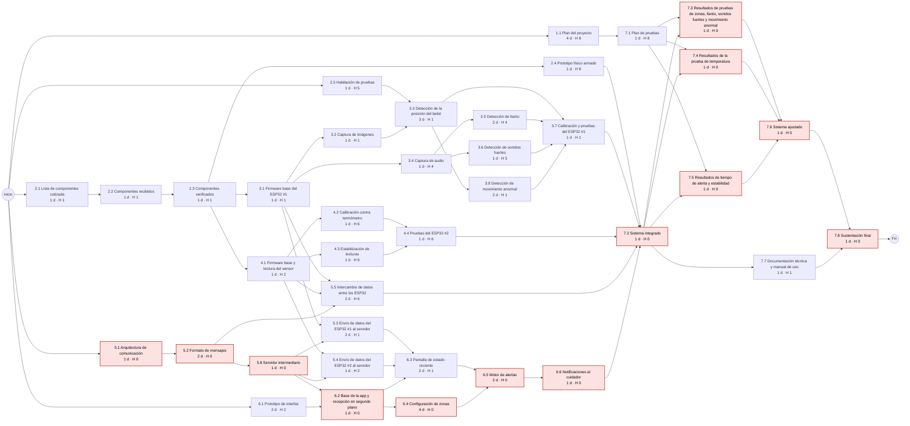
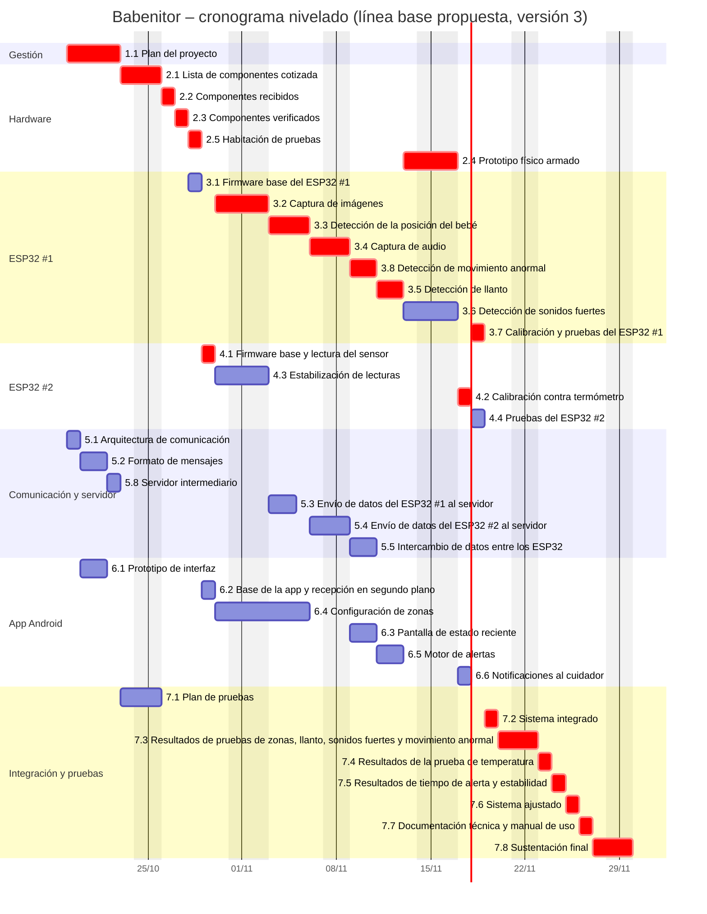

# Cronograma y Ruta Crítica – Babenitor

**Proyecto:** Babenitor – Sistema Inteligente de Monitoreo y Seguridad para Bebés
**Fuente:** `Docs/4. EDT.md` (paquetes de trabajo, horas, dependencias y OBS/RACI)
**Estado del documento:** Línea base congelada el 10/11/2026 (versión 3, con detección de movimiento anormal y 20 h por semana)

---


## Supuestos del cálculo

| Supuesto | Valor | De dónde sale |
| -------- | ----- | ------------- |
| Horas útiles por persona | **4 h por día hábil** (20 h por semana) | Decisión del equipo para incorporar la detección de movimiento anormal sin pasar del 07/12/2026 (la versión 2 usaba 15 h por semana y la versión 1, 10) |
| Fórmula de duración | duración = esfuerzo ÷ (personas × 4 h), redondeada hacia arriba | Paso 1 del codelab |
| Días de trabajo | Lunes a viernes, sin festivos de Colombia (02/11, 16/11 y 08/12 de 2026) | Calendario |
| Día 0 | **Lunes 19/10/2026** | Fecha en que se arma el cronograma |
| Fin esperado | **07/12/2026**, fecha de fin del proyecto fijada en el acta de constitución; el semestre termina unos 5 días después | Acta de constitución |
| Tipo de dependencia | Fin a comienzo (FC) en todas, sin adelantos ni retrasos | Diccionario de la EDT |
| Esfuerzo recurrente | 1.2, 1.3 y 1.4 (28 h) no entran en la red: se hacen en paralelo durante todo el proyecto | Marcados como [R] o ligados a las entregas en la EDT |
| Plan del proyecto (1.1) | Tarea ya en curso; se fija del 19/10 al 22/10/2026 con Jaime y Dilan | Hito H1 de la versión 1 |

Los días de las tablas son **días hábiles contados desde el día 0**. Un ES de 6 significa que la tarea puede empezar al comenzar el sexto día hábil.

---

## Paso 1 – Lista de tareas

Cada paquete de trabajo de la EDT es una tarea. El nombre, las horas y el criterio de aceptación se heredan del diccionario. Lo nuevo son las **personas que la realizan** y la **duración**.

Las personas salen de la OBS y la matriz RACI: todos son R en las áreas técnicas, y aquí se fija **quién la hace en este cronograma**. El líder de cada área (la A) está en todas las tareas de su área técnica. Las personas se eligieron con una búsqueda por recocido simulado, buscando la fecha de fin más temprana con las horas repartidas de forma pareja.

| Código | Tarea | Esfuerzo (h) | Personas (R) | N.º | Duración (días hábiles) |
| ------ | ----- | -----------: | ------------ | --: | ----------------------: |
| 1.1 | Plan del proyecto | 16 | Jaime, Dilan | 2 | 4 |
| 2.1 | Lista de componentes cotizada | 4 | Dilan | 1 | 1 |
| 2.2 | Componentes recibidos | 4 | Dilan, Daniel, Jaime | 3 | 1 |
| 2.3 | Componentes verificados | 6 | Dilan, Diego, Daniel | 3 | 1 |
| 2.4 | Prototipo físico armado | 10 | Dilan, Jaime, Daniel | 3 | 1 |
| 2.5 | Habitación de pruebas | 4 | Dilan, Daniel | 2 | 1 |
| 3.1 | Firmware base del ESP32 #1 | 8 | Diego, Juan José | 2 | 1 |
| 3.2 | Captura de imágenes | 10 | Diego, Dilan, Jaime | 3 | 1 |
| 3.3 | Detección de la posición del bebé | 20 | Diego, Dilan | 2 | 3 |
| 3.4 | Captura de audio | 10 | Diego, Dilan, Jaime | 3 | 1 |
| 3.5 | Detección de llanto | 16 | Diego, Daniel | 2 | 2 |
| 3.6 | Detección de sonidos fuertes | 4 | Diego | 1 | 1 |
| 3.7 | Calibración y pruebas del ESP32 #1 | 14 | Diego, Dilan, Juan José, Jaime | 4 | 1 |
| 3.8 | Detección de movimiento anormal | 16 | Diego, Jaime | 2 | 2 |
| 4.1 | Firmware base y lectura del sensor | 8 | Daniel, Jaime | 2 | 1 |
| 4.2 | Calibración contra termómetro | 10 | Daniel, Dilan, Diego | 3 | 1 |
| 4.3 | Estabilización de lecturas | 4 | Daniel | 1 | 1 |
| 4.4 | Pruebas del ESP32 #2 | 4 | Daniel | 1 | 1 |
| 5.1 | Arquitectura de comunicación | 6 | Daniel, Juan José | 2 | 1 |
| 5.2 | Formato de mensajes | 6 | Daniel | 1 | 2 |
| 5.3 | Envío de datos del ESP32 #1 al servidor | 12 | Daniel, Jaime | 2 | 2 |
| 5.4 | Envío de datos del ESP32 #2 al servidor | 8 | Daniel, Juan José | 2 | 1 |
| 5.5 | Intercambio de datos entre los ESP32 | 8 | Daniel | 1 | 2 |
| 5.8 | Servidor intermediario | 12 | Daniel, Juan José, Diego | 3 | 1 |
| 6.1 | Prototipo de interfaz | 10 | Juan José, Diego | 2 | 2 |
| 6.2 | Base de la app y recepción en segundo plano | 12 | Juan José, Diego, Dilan | 3 | 1 |
| 6.3 | Pantalla de estado reciente | 12 | Juan José, Dilan | 2 | 2 |
| 6.4 | Configuración de zonas | 14 | Juan José | 1 | 4 |
| 6.5 | Motor de alertas | 22 | Juan José, Jaime, Dilan | 3 | 2 |
| 6.6 | Notificaciones al cuidador | 8 | Juan José, Jaime | 2 | 1 |
| 7.1 | Plan de pruebas | 7 | Jaime, Juan José, Diego, Daniel | 4 | 1 |
| 7.2 | Sistema integrado | 16 | Jaime, Dilan, Diego, Juan José | 4 | 1 |
| 7.3 | Resultados de pruebas de zonas, llanto, sonidos fuertes y movimiento anormal | 15 | Jaime, Daniel, Dilan, Juan José | 4 | 1 |
| 7.4 | Resultados de la prueba de temperatura | 6 | Jaime, Daniel, Dilan | 3 | 1 |
| 7.5 | Resultados de tiempo de alerta y estabilidad | 8 | Jaime, Juan José, Diego, Dilan | 4 | 1 |
| 7.6 | Sistema ajustado | 12 | Jaime, Diego, Daniel | 3 | 1 |
| 7.7 | Documentación técnica y manual de uso | 8 | Jaime, Juan José | 2 | 1 |
| 7.8 | Sustentación final | 12 | Dilan, Jaime, Diego, Juan José, Daniel | 5 | 1 |

**Esfuerzo recurrente (fuera de la red):**

| Código | Tarea | Esfuerzo (h) | Personas | Cuándo |
| ------ | ----- | -----------: | -------- | ------ |
| 1.2 | Actas de seguimiento semanal | 16 | Los cinco (Dilan redacta) | Cada semana, del 19/10/2026 al cierre |
| 1.3 | Registro de riesgos y presupuesto | 6 | Dilan | Al cierre de cada mes |
| 1.4 | Informes de entregas parciales | 6 | Dilan, Jaime | Antes de cada entrega parcial que acuerden los patrocinadores |

**Horas de la red por persona** (sin las recurrentes): Dilan 76 h, Jaime 76 h, Diego 77 h, Juan José 77 h, Daniel 77 h. Suman 382 h, las horas de la red (la tarea 1.1 se cuenta con sus 16 h); con las 28 h recurrentes se llega a las 410 h de la EDT.

**Capacidad frente a carga:** del 19/10 al 04/12 hay 32 días hábiles. Con 5 personas a 4 h por día, la capacidad es de 640 h; la EDT pide 410 h, es decir, el 64 %. El resto es el margen para imprevistos.

---

## Paso 2 – Las dependencias

Las dependencias son las del diccionario de la EDT ("Depende de"), ya sin las redundantes y con una agregada. Para cada una se escribe **por qué** existe:

- **Obligatoria:** viene de la naturaleza del trabajo.

- **Obligatoria:** viene de la naturaleza del trabajo.
- **Decidida:** la eligió el equipo y se puede cambiar si hay que comprimir.

| Tarea | Depende de | Tipo | Clase | Por qué |
| ----- | ---------- | ---- | ----- | ------- |
| 2.2 Componentes recibidos | 2.1 | FC | Obligatoria | no se compra lo que no está en la lista aprobada |
| 2.3 Componentes verificados | 2.2 | FC | Obligatoria | no se prueba un componente que no ha llegado |
| 2.4 Prototipo físico armado | 2.3 | FC | Obligatoria | no se arma con piezas sin verificar |
| 3.1 Firmware base del ESP32 #1 | 2.3 | FC | Obligatoria | el firmware se carga en un ESP32-CAM que ya enciende y se programa |
| 3.2 Captura de imágenes | 3.1 | FC | Obligatoria | la captura corre sobre el firmware base |
| 3.3 Detección de la posición del bebé | 2.5 | FC | Obligatoria | el criterio se mide contra las zonas marcadas en la habitación |
| 3.3 Detección de la posición del bebé | 3.2 | FC | Obligatoria | el algoritmo trabaja sobre las imágenes capturadas |
| 3.4 Captura de audio | 3.1 | FC | Obligatoria | la captura de audio corre sobre el firmware base |
| 3.5 Detección de llanto | 3.4 | FC | Obligatoria | el análisis de frecuencia necesita el audio muestreado |
| 3.6 Detección de sonidos fuertes | 3.4 | FC | Obligatoria | el umbral se aplica al volumen que entrega 3.4 |
| 3.7 Calibración y pruebas del ESP32 #1 | 3.3 | FC | Obligatoria | se calibran los tres detectores |
| 3.7 Calibración y pruebas del ESP32 #1 | 3.5 | FC | Obligatoria | ídem |
| 3.7 Calibración y pruebas del ESP32 #1 | 3.6 | FC | Obligatoria | ídem |
| 3.7 Calibración y pruebas del ESP32 #1 | 3.8 | FC | Obligatoria | ídem (se calibra también el detector de movimiento anormal) |
| 3.8 Detección de movimiento anormal | 3.3 | FC | Obligatoria | las posiciones, caídas y el movimiento anormal se analizan con las coordenadas que entrega 3.3 |
| 4.1 Firmware base y lectura del sensor | 2.3 | FC | Obligatoria | el sensor y el ESP32 #2 deben estar verificados |
| 4.2 Calibración contra termómetro | 4.1 | FC | Obligatoria | se calibra una lectura que ya existe |
| 4.3 Estabilización de lecturas | 4.1 | FC | Obligatoria | se filtra una lectura que ya existe |
| 4.4 Pruebas del ESP32 #2 | 4.2 | FC | Obligatoria | se prueba el dispositivo ya calibrado |
| 4.4 Pruebas del ESP32 #2 | 4.3 | FC | Obligatoria | y con la lectura estable |
| 5.2 Formato de mensajes | 5.1 | FC | Obligatoria | los mensajes siguen la arquitectura y el protocolo elegidos |
| 5.3 Envío de datos del ESP32 #1 al servidor | 3.1 | FC | Obligatoria | el envío corre en el firmware del ESP32 #1 |
| 5.3 Envío de datos del ESP32 #1 al servidor | 5.8 | FC | Obligatoria | sin servidor no hay a dónde enviar |
| 5.4 Envío de datos del ESP32 #2 al servidor | 4.1 | FC | Obligatoria | se envía la lectura que produce 4.1 |
| 5.4 Envío de datos del ESP32 #2 al servidor | 5.8 | FC | Obligatoria | sin servidor no hay a dónde enviar |
| 5.5 Intercambio de datos entre los ESP32 | 3.1 | FC | Obligatoria | firmware del ESP32 #1 |
| 5.5 Intercambio de datos entre los ESP32 | 4.1 | FC | Obligatoria | firmware del ESP32 #2 |
| 5.5 Intercambio de datos entre los ESP32 | 5.2 | FC | Obligatoria | los ESP32 intercambian mensajes con el formato acordado |
| 5.8 Servidor intermediario | 5.2 | FC | Obligatoria | el servidor retransmite los mensajes definidos |
| 6.2 Base de la app y recepción en segundo plano | 5.8 | FC | Obligatoria | la app recibe los datos desde el servidor |
| 6.2 Base de la app y recepción en segundo plano | 6.1 | FC | Decidida | el equipo decidió aprobar las pantallas antes de programar; el proyecto Android podría arrancar antes |
| 6.3 Pantalla de estado reciente | 5.3 | FC | Obligatoria | el criterio exige datos reales del servidor, no escritos en el código |
| 6.3 Pantalla de estado reciente | 5.4 | FC | Obligatoria | ídem para la temperatura |
| 6.3 Pantalla de estado reciente | 6.2 | FC | Obligatoria | la pantalla vive en la app base |
| 6.4 Configuración de zonas | 6.2 | FC | Obligatoria | las zonas se configuran dentro de la app base |
| 6.5 Motor de alertas | 6.3 | FC | Obligatoria | las reglas usan los datos recibidos |
| 6.5 Motor de alertas | 6.4 | FC | Obligatoria | y las zonas configuradas |
| 6.6 Notificaciones al cuidador | 6.5 | FC | Obligatoria | se notifica la alerta que genera el motor |
| 7.1 Plan de pruebas | 1.1 | FC | Decidida | el plan de pruebas sale de los criterios del acta, que ya existen; se ató al plan por orden del equipo |
| 7.2 Sistema integrado | 2.4 | FC | Obligatoria (agregada) | se integra sobre el prototipo físico armado y fijo; la EDT versión 1 no la tenía |
| 7.2 Sistema integrado | 3.7 | FC | Obligatoria | se integra el ESP32 #1 ya probado |
| 7.2 Sistema integrado | 4.4 | FC | Obligatoria | el ESP32 #2 ya probado |
| 7.2 Sistema integrado | 5.5 | FC | Obligatoria | el intercambio entre ESP32 |
| 7.2 Sistema integrado | 6.6 | FC | Obligatoria | y la app que ya notifica |
| 7.3 Resultados de pruebas de zonas, llanto, sonidos fuertes y movimiento anormal | 7.1 | FC | Obligatoria | se ejecutan los casos del plan |
| 7.3 Resultados de pruebas de zonas, llanto, sonidos fuertes y movimiento anormal | 7.2 | FC | Obligatoria | sobre el sistema integrado |
| 7.4 Resultados de la prueba de temperatura | 7.1 | FC | Obligatoria | se ejecutan los casos del plan |
| 7.4 Resultados de la prueba de temperatura | 7.2 | FC | Obligatoria | sobre el sistema integrado |
| 7.5 Resultados de tiempo de alerta y estabilidad | 7.1 | FC | Obligatoria | se ejecutan los casos del plan |
| 7.5 Resultados de tiempo de alerta y estabilidad | 7.2 | FC | Obligatoria | sobre el sistema integrado |
| 7.6 Sistema ajustado | 7.3 | FC | Obligatoria | se corrige según los resultados |
| 7.6 Sistema ajustado | 7.4 | FC | Obligatoria | se corrige según los resultados |
| 7.6 Sistema ajustado | 7.5 | FC | Obligatoria | se corrige según los resultados |
| 7.7 Documentación técnica y manual de uso | 7.2 | FC | Decidida (cambiada) | la documentación se escribe mientras se prueba y se ajusta; antes dependía de 7.6. Es la compresión en paralelo del Paso 7 |
| 7.8 Sustentación final | 7.6 | FC | Obligatoria | se sustenta con el sistema ya ajustado |
| 7.8 Sustentación final | 7.7 | FC | Obligatoria | se sustenta con la documentación entregada |

**Resumen:**

- **56 dependencias**, todas fin a comienzo.
- **Dependencias nuevas de la versión 3:** 3.3 → 3.8 y 3.8 → 3.7 (el detector de movimiento anormal usa las coordenadas de 3.3 y se calibra en 3.7).
- **Dependencia agregada en la versión 2: 2.4 → 7.2.** En la EDT versión 1, *2.4 Prototipo físico armado* no tenía ninguna tarea después. Ahora queda en el diccionario.
- **Decididas (3):** 6.1 → 6.2, 1.1 → 7.1 y 7.2 → 7.7. La última reemplaza a la 7.6 → 7.7 de la versión 1. Son las primeras candidatas si hay que comprimir más.
- Se quitaron las 7 dependencias redundantes del diccionario, y con 5.6, 5.7 y 6.7 fuera del alcance, desaparecieron sus dependencias.

### Diagrama de red

Cada nodo muestra la duración (d) y la holgura (H). En rojo, las tareas críticas. No se dibujan las dependencias redundantes.



---

## Paso 3 – El recorrido hacia adelante

Para cada tarea, en orden: **ES** (inicio más temprano) = el mayor EF de sus predecesoras (0 si no tiene) y **EF** (fin más temprano) = ES + duración.

El mayor EF es **16 días hábiles**: es la duración mínima del proyecto con recursos ilimitados. Contando desde el 19/10/2026, termina el **10/11/2026**.

## Paso 4 – El recorrido hacia atrás y la holgura

En orden inverso, empezando con LF = 16 en las tareas que no tienen sucesoras: **LF** (fin más tardío) = el menor LS de sus sucesoras y **LS** (inicio más tardío) = LF − duración. Luego, **holgura = LS − ES**.

| Código | Tarea | Dur. | ES | EF | LS | LF | Holgura | Crítica |
| ------ | ----- | ---: | -: | -: | -: | -: | ------: | :-----: |
| 5.1 | Arquitectura de comunicación | 1 | 0 | 1 | 0 | 1 | 0 | **Sí** |
| 2.1 | Lista de componentes cotizada | 1 | 0 | 1 | 1 | 2 | 1 |  |
| 6.1 | Prototipo de interfaz | 2 | 0 | 2 | 2 | 4 | 2 |  |
| 2.5 | Habitación de pruebas | 1 | 0 | 1 | 5 | 6 | 5 |  |
| 1.1 | Plan del proyecto | 4 | 0 | 4 | 8 | 12 | 8 |  |
| 5.2 | Formato de mensajes | 2 | 1 | 3 | 1 | 3 | 0 | **Sí** |
| 2.2 | Componentes recibidos | 1 | 1 | 2 | 2 | 3 | 1 |  |
| 2.3 | Componentes verificados | 1 | 2 | 3 | 3 | 4 | 1 |  |
| 5.8 | Servidor intermediario | 1 | 3 | 4 | 3 | 4 | 0 | **Sí** |
| 3.1 | Firmware base del ESP32 #1 | 1 | 3 | 4 | 4 | 5 | 1 |  |
| 4.1 | Firmware base y lectura del sensor | 1 | 3 | 4 | 5 | 6 | 2 |  |
| 2.4 | Prototipo físico armado | 1 | 3 | 4 | 11 | 12 | 8 |  |
| 6.2 | Base de la app y recepción en segundo plano | 1 | 4 | 5 | 4 | 5 | 0 | **Sí** |
| 3.2 | Captura de imágenes | 1 | 4 | 5 | 5 | 6 | 1 |  |
| 5.3 | Envío de datos del ESP32 #1 al servidor | 2 | 4 | 6 | 5 | 7 | 1 |  |
| 5.4 | Envío de datos del ESP32 #2 al servidor | 1 | 4 | 5 | 6 | 7 | 2 |  |
| 3.4 | Captura de audio | 1 | 4 | 5 | 8 | 9 | 4 |  |
| 4.2 | Calibración contra termómetro | 1 | 4 | 5 | 10 | 11 | 6 |  |
| 4.3 | Estabilización de lecturas | 1 | 4 | 5 | 10 | 11 | 6 |  |
| 5.5 | Intercambio de datos entre los ESP32 | 2 | 4 | 6 | 10 | 12 | 6 |  |
| 7.1 | Plan de pruebas | 1 | 4 | 5 | 12 | 13 | 8 |  |
| 6.4 | Configuración de zonas | 4 | 5 | 9 | 5 | 9 | 0 | **Sí** |
| 3.3 | Detección de la posición del bebé | 3 | 5 | 8 | 6 | 9 | 1 |  |
| 3.5 | Detección de llanto | 2 | 5 | 7 | 9 | 11 | 4 |  |
| 3.6 | Detección de sonidos fuertes | 1 | 5 | 6 | 10 | 11 | 5 |  |
| 4.4 | Pruebas del ESP32 #2 | 1 | 5 | 6 | 11 | 12 | 6 |  |
| 6.3 | Pantalla de estado reciente | 2 | 6 | 8 | 7 | 9 | 1 |  |
| 3.8 | Detección de movimiento anormal | 2 | 8 | 10 | 9 | 11 | 1 |  |
| 6.5 | Motor de alertas | 2 | 9 | 11 | 9 | 11 | 0 | **Sí** |
| 3.7 | Calibración y pruebas del ESP32 #1 | 1 | 10 | 11 | 11 | 12 | 1 |  |
| 6.6 | Notificaciones al cuidador | 1 | 11 | 12 | 11 | 12 | 0 | **Sí** |
| 7.2 | Sistema integrado | 1 | 12 | 13 | 12 | 13 | 0 | **Sí** |
| 7.3 | Resultados de pruebas de zonas, llanto, sonidos fuertes y movimiento anormal | 1 | 13 | 14 | 13 | 14 | 0 | **Sí** |
| 7.4 | Resultados de la prueba de temperatura | 1 | 13 | 14 | 13 | 14 | 0 | **Sí** |
| 7.5 | Resultados de tiempo de alerta y estabilidad | 1 | 13 | 14 | 13 | 14 | 0 | **Sí** |
| 7.7 | Documentación técnica y manual de uso | 1 | 13 | 14 | 14 | 15 | 1 |  |
| 7.6 | Sistema ajustado | 1 | 14 | 15 | 14 | 15 | 0 | **Sí** |
| 7.8 | Sustentación final | 1 | 15 | 16 | 15 | 16 | 0 | **Sí** |

---

## Paso 5 – La ruta crítica

Las tareas con holgura cero son: 5.1, 5.2, 5.8, 6.2, 6.4, 6.5, 6.6, 7.2, 7.3, 7.4, 7.5, 7.6, 7.8.

Una cadena continua de holgura cero, de principio a fin:

```
5.1 → 5.2 → 5.8 → 6.2 → 6.4 → 6.5 → 6.6 → 7.2 → 7.3 → 7.6 → 7.8
```

**Comprobación:** 5.1 (1) + 5.2 (2) + 5.8 (1) + 6.2 (1) + 6.4 (4) + 6.5 (2) + 6.6 (1) + 7.2 (1) + 7.3 (1) + 7.6 (1) + 7.8 (1) = **16 días**, igual a la duración mínima del proyecto (16 días).

**Lectura:**

- Con tantas personas por tarea, la ruta crítica sin límite de recursos es corta (16 días). Lo que fija la fecha real es **quién está libre**, no las dependencias; por eso importa más el Paso 6.
- La detección de movimiento anormal (3.8) depende de 3.3 y precede a la calibración 3.7, por lo que entra en la cadena del ESP32 #1 si esta se retrasa.

---

## Paso 6 – El cronograma contra el equipo real

La ruta crítica de 16 días supone que siempre hay alguien libre para cada tarea. Con los cinco integrantes, varias tareas se cruzan en la misma persona. Se resolvió así:

1. Las tareas se programan en orden de **menor LS** (primero la que menos margen tiene), dando prioridad a las tareas del hito de integración del acta. El plan del proyecto (1.1) se fija al inicio porque ya está en curso.
2. Si alguna de sus personas está ocupada, la tarea se mueve al primer día en que **todas** estén libres.
3. El reparto de personas se eligió con una búsqueda por recocido simulado sobre miles de combinaciones, con estas reglas: el líder en todas las tareas de su área, hasta 4 personas por tarea (5 en la sustentación), y se prefirió la fecha más temprana, con las horas repartidas de forma pareja y con las tareas del hito de integración del acta (3.2, 3.4, 4.1 y 5.5) terminadas a más tardar el 10/11.

**Resultado:** con el equipo real y 20 h por semana por persona, el proyecto dura **28 días hábiles** y termina el **27/11/2026**. Son 12 días más que la ruta crítica sin recursos, porque esa cifra es un **piso**, no una promesa. La fecha de fin del acta es el 07/12/2026, así que quedan **6 días hábiles de holgura** frente a ella.

**Cadena que fija la fecha con recursos** (cada tarea empieza justo cuando termina la anterior, por dependencia o porque comparten persona):


1. 1.1 Plan del proyecto (Jaime, Dilan): 19/10/2026 – 22/10/2026
2. 2.1 Lista de componentes cotizada (Dilan): 23/10/2026 – 23/10/2026
3. 2.2 Componentes recibidos (Dilan, Daniel, Jaime): 26/10/2026 – 26/10/2026
4. 2.3 Componentes verificados (Dilan, Diego, Daniel): 27/10/2026 – 27/10/2026
5. 2.5 Habitación de pruebas (Dilan, Daniel): 28/10/2026 – 28/10/2026
6. 4.1 Firmware base y lectura del sensor (Daniel, Jaime): 29/10/2026 – 29/10/2026
7. 3.2 Captura de imágenes (Diego, Dilan, Jaime): 30/10/2026 – 30/10/2026
8. 3.3 Detección de la posición del bebé (Diego, Dilan): 03/11/2026 – 05/11/2026
9. 3.4 Captura de audio (Diego, Dilan, Jaime): 06/11/2026 – 06/11/2026
10. 3.8 Detección de movimiento anormal (Diego, Jaime): 09/11/2026 – 10/11/2026
11. 3.5 Detección de llanto (Diego, Daniel): 11/11/2026 – 12/11/2026
12. 2.4 Prototipo físico armado (Dilan, Jaime, Daniel): 13/11/2026 – 13/11/2026
13. 4.2 Calibración contra termómetro (Daniel, Dilan, Diego): 17/11/2026 – 17/11/2026
14. 3.7 Calibración y pruebas del ESP32 #1 (Diego, Dilan, Juan José, Jaime): 18/11/2026 – 18/11/2026
15. 7.2 Sistema integrado (Jaime, Dilan, Diego, Juan José): 19/11/2026 – 19/11/2026
16. 7.3 Resultados de pruebas de zonas, llanto, sonidos fuertes y movimiento anormal (Jaime, Daniel, Dilan, Juan José): 20/11/2026 – 20/11/2026
17. 7.4 Resultados de la prueba de temperatura (Jaime, Daniel, Dilan): 23/11/2026 – 23/11/2026
18. 7.5 Resultados de tiempo de alerta y estabilidad (Jaime, Juan José, Diego, Dilan): 24/11/2026 – 24/11/2026
19. 7.6 Sistema ajustado (Jaime, Diego, Daniel): 25/11/2026 – 25/11/2026
20. 7.7 Documentación técnica y manual de uso (Jaime, Juan José): 26/11/2026 – 26/11/2026
21. 7.8 Sustentación final (Dilan, Jaime, Diego, Juan José, Daniel): 27/11/2026 – 27/11/2026

### Cronograma nivelado

| Código | Tarea | Personas | Inicio | Fin | Días |
| ------ | ----- | -------- | ------ | --- | ---: |
| 1.1 | Plan del proyecto | Jaime, Dilan | 19/10/2026 | 22/10/2026 | 4 |
| 5.1 | Arquitectura de comunicación | Daniel, Juan José | 19/10/2026 | 19/10/2026 | 1 |
| 5.2 | Formato de mensajes | Daniel | 20/10/2026 | 21/10/2026 | 2 |
| 6.1 | Prototipo de interfaz | Juan José, Diego | 20/10/2026 | 21/10/2026 | 2 |
| 5.8 | Servidor intermediario | Daniel, Juan José, Diego | 22/10/2026 | 22/10/2026 | 1 |
| 2.1 | Lista de componentes cotizada | Dilan | 23/10/2026 | 23/10/2026 | 1 |
| 7.1 | Plan de pruebas | Jaime, Juan José, Diego, Daniel | 23/10/2026 | 23/10/2026 | 1 |
| 2.2 | Componentes recibidos | Dilan, Daniel, Jaime | 26/10/2026 | 26/10/2026 | 1 |
| 2.3 | Componentes verificados | Dilan, Diego, Daniel | 27/10/2026 | 27/10/2026 | 1 |
| 2.5 | Habitación de pruebas | Dilan, Daniel | 28/10/2026 | 28/10/2026 | 1 |
| 3.1 | Firmware base del ESP32 #1 | Diego, Juan José | 28/10/2026 | 28/10/2026 | 1 |
| 4.1 | Firmware base y lectura del sensor | Daniel, Jaime | 29/10/2026 | 29/10/2026 | 1 |
| 6.2 | Base de la app y recepción en segundo plano | Juan José, Diego, Dilan | 29/10/2026 | 29/10/2026 | 1 |
| 3.2 | Captura de imágenes | Diego, Dilan, Jaime | 30/10/2026 | 30/10/2026 | 1 |
| 4.3 | Estabilización de lecturas | Daniel | 30/10/2026 | 30/10/2026 | 1 |
| 6.4 | Configuración de zonas | Juan José | 30/10/2026 | 05/11/2026 | 4 |
| 3.3 | Detección de la posición del bebé | Diego, Dilan | 03/11/2026 | 05/11/2026 | 3 |
| 5.3 | Envío de datos del ESP32 #1 al servidor | Daniel, Jaime | 03/11/2026 | 04/11/2026 | 2 |
| 3.4 | Captura de audio | Diego, Dilan, Jaime | 06/11/2026 | 06/11/2026 | 1 |
| 5.4 | Envío de datos del ESP32 #2 al servidor | Daniel, Juan José | 06/11/2026 | 06/11/2026 | 1 |
| 3.8 | Detección de movimiento anormal | Diego, Jaime | 09/11/2026 | 10/11/2026 | 2 |
| 5.5 | Intercambio de datos entre los ESP32 | Daniel | 09/11/2026 | 10/11/2026 | 2 |
| 6.3 | Pantalla de estado reciente | Juan José, Dilan | 09/11/2026 | 10/11/2026 | 2 |
| 3.5 | Detección de llanto | Diego, Daniel | 11/11/2026 | 12/11/2026 | 2 |
| 6.5 | Motor de alertas | Juan José, Jaime, Dilan | 11/11/2026 | 12/11/2026 | 2 |
| 2.4 | Prototipo físico armado | Dilan, Jaime, Daniel | 13/11/2026 | 13/11/2026 | 1 |
| 3.6 | Detección de sonidos fuertes | Diego | 13/11/2026 | 13/11/2026 | 1 |
| 4.2 | Calibración contra termómetro | Daniel, Dilan, Diego | 17/11/2026 | 17/11/2026 | 1 |
| 6.6 | Notificaciones al cuidador | Juan José, Jaime | 17/11/2026 | 17/11/2026 | 1 |
| 3.7 | Calibración y pruebas del ESP32 #1 | Diego, Dilan, Juan José, Jaime | 18/11/2026 | 18/11/2026 | 1 |
| 4.4 | Pruebas del ESP32 #2 | Daniel | 18/11/2026 | 18/11/2026 | 1 |
| 7.2 | Sistema integrado | Jaime, Dilan, Diego, Juan José | 19/11/2026 | 19/11/2026 | 1 |
| 7.3 | Resultados de pruebas de zonas, llanto, sonidos fuertes y movimiento anormal | Jaime, Daniel, Dilan, Juan José | 20/11/2026 | 20/11/2026 | 1 |
| 7.4 | Resultados de la prueba de temperatura | Jaime, Daniel, Dilan | 23/11/2026 | 23/11/2026 | 1 |
| 7.5 | Resultados de tiempo de alerta y estabilidad | Jaime, Juan José, Diego, Dilan | 24/11/2026 | 24/11/2026 | 1 |
| 7.6 | Sistema ajustado | Jaime, Diego, Daniel | 25/11/2026 | 25/11/2026 | 1 |
| 7.7 | Documentación técnica y manual de uso | Jaime, Juan José | 26/11/2026 | 26/11/2026 | 1 |
| 7.8 | Sustentación final | Dilan, Jaime, Diego, Juan José, Daniel | 27/11/2026 | 27/11/2026 | 1 |

### Calendario de cada persona

Verificado: **nadie está en dos tareas el mismo día.**

**Dilan** (76 h de tareas de la red)

| Tarea | Inicio | Fin |
| ----- | ------ | --- |
| 1.1 Plan del proyecto | 19/10/2026 | 22/10/2026 |
| 2.1 Lista de componentes cotizada | 23/10/2026 | 23/10/2026 |
| 2.2 Componentes recibidos | 26/10/2026 | 26/10/2026 |
| 2.3 Componentes verificados | 27/10/2026 | 27/10/2026 |
| 2.5 Habitación de pruebas | 28/10/2026 | 28/10/2026 |
| 6.2 Base de la app y recepción en segundo plano | 29/10/2026 | 29/10/2026 |
| 3.2 Captura de imágenes | 30/10/2026 | 30/10/2026 |
| 3.3 Detección de la posición del bebé | 03/11/2026 | 05/11/2026 |
| 3.4 Captura de audio | 06/11/2026 | 06/11/2026 |
| 6.3 Pantalla de estado reciente | 09/11/2026 | 10/11/2026 |
| 6.5 Motor de alertas | 11/11/2026 | 12/11/2026 |
| 2.4 Prototipo físico armado | 13/11/2026 | 13/11/2026 |
| 4.2 Calibración contra termómetro | 17/11/2026 | 17/11/2026 |
| 3.7 Calibración y pruebas del ESP32 #1 | 18/11/2026 | 18/11/2026 |
| 7.2 Sistema integrado | 19/11/2026 | 19/11/2026 |
| 7.3 Resultados de pruebas de zonas, llanto, sonidos fuertes y movimiento anormal | 20/11/2026 | 20/11/2026 |
| 7.4 Resultados de la prueba de temperatura | 23/11/2026 | 23/11/2026 |
| 7.5 Resultados de tiempo de alerta y estabilidad | 24/11/2026 | 24/11/2026 |
| 7.8 Sustentación final | 27/11/2026 | 27/11/2026 |

**Jaime** (76 h de tareas de la red)

| Tarea | Inicio | Fin |
| ----- | ------ | --- |
| 1.1 Plan del proyecto | 19/10/2026 | 22/10/2026 |
| 7.1 Plan de pruebas | 23/10/2026 | 23/10/2026 |
| 2.2 Componentes recibidos | 26/10/2026 | 26/10/2026 |
| 4.1 Firmware base y lectura del sensor | 29/10/2026 | 29/10/2026 |
| 3.2 Captura de imágenes | 30/10/2026 | 30/10/2026 |
| 5.3 Envío de datos del ESP32 #1 al servidor | 03/11/2026 | 04/11/2026 |
| 3.4 Captura de audio | 06/11/2026 | 06/11/2026 |
| 3.8 Detección de movimiento anormal | 09/11/2026 | 10/11/2026 |
| 6.5 Motor de alertas | 11/11/2026 | 12/11/2026 |
| 2.4 Prototipo físico armado | 13/11/2026 | 13/11/2026 |
| 6.6 Notificaciones al cuidador | 17/11/2026 | 17/11/2026 |
| 3.7 Calibración y pruebas del ESP32 #1 | 18/11/2026 | 18/11/2026 |
| 7.2 Sistema integrado | 19/11/2026 | 19/11/2026 |
| 7.3 Resultados de pruebas de zonas, llanto, sonidos fuertes y movimiento anormal | 20/11/2026 | 20/11/2026 |
| 7.4 Resultados de la prueba de temperatura | 23/11/2026 | 23/11/2026 |
| 7.5 Resultados de tiempo de alerta y estabilidad | 24/11/2026 | 24/11/2026 |
| 7.6 Sistema ajustado | 25/11/2026 | 25/11/2026 |
| 7.7 Documentación técnica y manual de uso | 26/11/2026 | 26/11/2026 |
| 7.8 Sustentación final | 27/11/2026 | 27/11/2026 |

**Diego** (77 h de tareas de la red)

| Tarea | Inicio | Fin |
| ----- | ------ | --- |
| 6.1 Prototipo de interfaz | 20/10/2026 | 21/10/2026 |
| 5.8 Servidor intermediario | 22/10/2026 | 22/10/2026 |
| 7.1 Plan de pruebas | 23/10/2026 | 23/10/2026 |
| 2.3 Componentes verificados | 27/10/2026 | 27/10/2026 |
| 3.1 Firmware base del ESP32 #1 | 28/10/2026 | 28/10/2026 |
| 6.2 Base de la app y recepción en segundo plano | 29/10/2026 | 29/10/2026 |
| 3.2 Captura de imágenes | 30/10/2026 | 30/10/2026 |
| 3.3 Detección de la posición del bebé | 03/11/2026 | 05/11/2026 |
| 3.4 Captura de audio | 06/11/2026 | 06/11/2026 |
| 3.8 Detección de movimiento anormal | 09/11/2026 | 10/11/2026 |
| 3.5 Detección de llanto | 11/11/2026 | 12/11/2026 |
| 3.6 Detección de sonidos fuertes | 13/11/2026 | 13/11/2026 |
| 4.2 Calibración contra termómetro | 17/11/2026 | 17/11/2026 |
| 3.7 Calibración y pruebas del ESP32 #1 | 18/11/2026 | 18/11/2026 |
| 7.2 Sistema integrado | 19/11/2026 | 19/11/2026 |
| 7.5 Resultados de tiempo de alerta y estabilidad | 24/11/2026 | 24/11/2026 |
| 7.6 Sistema ajustado | 25/11/2026 | 25/11/2026 |
| 7.8 Sustentación final | 27/11/2026 | 27/11/2026 |

**Juan José** (77 h de tareas de la red)

| Tarea | Inicio | Fin |
| ----- | ------ | --- |
| 5.1 Arquitectura de comunicación | 19/10/2026 | 19/10/2026 |
| 6.1 Prototipo de interfaz | 20/10/2026 | 21/10/2026 |
| 5.8 Servidor intermediario | 22/10/2026 | 22/10/2026 |
| 7.1 Plan de pruebas | 23/10/2026 | 23/10/2026 |
| 3.1 Firmware base del ESP32 #1 | 28/10/2026 | 28/10/2026 |
| 6.2 Base de la app y recepción en segundo plano | 29/10/2026 | 29/10/2026 |
| 6.4 Configuración de zonas | 30/10/2026 | 05/11/2026 |
| 5.4 Envío de datos del ESP32 #2 al servidor | 06/11/2026 | 06/11/2026 |
| 6.3 Pantalla de estado reciente | 09/11/2026 | 10/11/2026 |
| 6.5 Motor de alertas | 11/11/2026 | 12/11/2026 |
| 6.6 Notificaciones al cuidador | 17/11/2026 | 17/11/2026 |
| 3.7 Calibración y pruebas del ESP32 #1 | 18/11/2026 | 18/11/2026 |
| 7.2 Sistema integrado | 19/11/2026 | 19/11/2026 |
| 7.3 Resultados de pruebas de zonas, llanto, sonidos fuertes y movimiento anormal | 20/11/2026 | 20/11/2026 |
| 7.5 Resultados de tiempo de alerta y estabilidad | 24/11/2026 | 24/11/2026 |
| 7.7 Documentación técnica y manual de uso | 26/11/2026 | 26/11/2026 |
| 7.8 Sustentación final | 27/11/2026 | 27/11/2026 |

**Daniel** (77 h de tareas de la red)

| Tarea | Inicio | Fin |
| ----- | ------ | --- |
| 5.1 Arquitectura de comunicación | 19/10/2026 | 19/10/2026 |
| 5.2 Formato de mensajes | 20/10/2026 | 21/10/2026 |
| 5.8 Servidor intermediario | 22/10/2026 | 22/10/2026 |
| 7.1 Plan de pruebas | 23/10/2026 | 23/10/2026 |
| 2.2 Componentes recibidos | 26/10/2026 | 26/10/2026 |
| 2.3 Componentes verificados | 27/10/2026 | 27/10/2026 |
| 2.5 Habitación de pruebas | 28/10/2026 | 28/10/2026 |
| 4.1 Firmware base y lectura del sensor | 29/10/2026 | 29/10/2026 |
| 4.3 Estabilización de lecturas | 30/10/2026 | 30/10/2026 |
| 5.3 Envío de datos del ESP32 #1 al servidor | 03/11/2026 | 04/11/2026 |
| 5.4 Envío de datos del ESP32 #2 al servidor | 06/11/2026 | 06/11/2026 |
| 5.5 Intercambio de datos entre los ESP32 | 09/11/2026 | 10/11/2026 |
| 3.5 Detección de llanto | 11/11/2026 | 12/11/2026 |
| 2.4 Prototipo físico armado | 13/11/2026 | 13/11/2026 |
| 4.2 Calibración contra termómetro | 17/11/2026 | 17/11/2026 |
| 4.4 Pruebas del ESP32 #2 | 18/11/2026 | 18/11/2026 |
| 7.3 Resultados de pruebas de zonas, llanto, sonidos fuertes y movimiento anormal | 20/11/2026 | 20/11/2026 |
| 7.4 Resultados de la prueba de temperatura | 23/11/2026 | 23/11/2026 |
| 7.6 Sistema ajustado | 25/11/2026 | 25/11/2026 |
| 7.8 Sustentación final | 27/11/2026 | 27/11/2026 |

### Diagrama de Gantt

En rojo, la cadena que fija la fecha con recursos.



---

## Paso 7 – Recorte de alcance y cambios de la versión 3

La versión 1 pedía 682 h y terminaba el 01/02/2027. Para cerrar el semestre había que hacer dos cosas a la vez: **subir la dedicación a 15 h por semana** (capacidad de 480 h en 32 días hábiles) y **recortar la EDT a 386 h**. Los criterios de éxito del acta (zonas, llanto, sonidos fuertes, temperatura, tiempo de alerta y comunicación) **se mantienen todos**; lo que sale es lo que el acta no mide.

**Salen del alcance (requieren aprobación de los patrocinadores, ver puntos a revisar):**

| Paquete | Horas | Requisito afectado | Efecto |
| ------- | ----: | ------------------ | ------ |
| 5.6 Reconexión automática | 10 | RNF-05 | Si un ESP32 pierde la conexión, se reinicia a mano |
| 5.7 Privacidad y acceso autorizado | 12 | RNF-08 (y parte de RNF-07) | Sin credenciales por dispositivo; el audio y video crudos siguen sin salir del ESP32 por diseño (5.1) |
| 6.7 Historial de alertas | 12 | RF-12 | La app notifica cada alerta, pero no guarda la lista |

**Se reducen (mismo entregable, versión mínima):**

| Bloque | Antes | Ahora | Qué se simplifica |
| ------ | ----: | ----: | ----------------- |
| 1.0 Gestión | 92 | 44 | Actas, registro de riesgos e informes más cortos |
| 2.0 Hardware | 48 | 28 | Lista, compra y verificación de pocos componentes |
| 3.0 ESP32 #1 | 140 | 80 | Detección con el mínimo que exigen los criterios del acta (8 de 10) |
| 4.0 ESP32 #2 | 40 | 26 | Calibración y estabilización más breves |
| 5.0 Comunicación | 102 | 52 | Sin 5.6 ni 5.7; mensajes y envío más simples |
| 6.0 App móvil | 132 | 76 | Sin 6.7; interfaz y zonas en versión mínima |
| 7.0 Integración y pruebas | 128 | 80 | Menos horas de ajuste, documentación y sustentación |
| **Total** | **682** | **386** | |

**Compresión en paralelo:** 7.7 *Documentación* pasa a depender de 7.2 y no de 7.6; se escribe mientras se prueba y se ajusta.

### Versión 3: detección de movimiento anormal y 20 h por semana

El acta incorporó tres detecciones nuevas basadas en la imagen: posición antinatural, caída y movimiento tipo convulsión (RF-13, RF-14 y RF-15). Se agregaron al cronograma como **un solo paquete, 3.8 Detección de movimiento anormal (16 h)**, porque las tres se resuelven con el mismo análisis de cuadros consecutivos del ESP32 #1. Además suben las horas de los paquetes que las prueban o las usan:

| Paquete | Antes | Ahora | Por qué cambia |
| ------- | ----: | ----: | -------------- |
| 3.8 Detección de movimiento anormal | — | 16 | Paquete nuevo: posición antinatural, caída y movimiento tipo convulsión |
| 3.7 Calibración y pruebas del ESP32 #1 | 12 | 14 | Calibra también el detector nuevo |
| 6.5 Motor de alertas | 20 | 22 | Tres tipos de alerta más |
| 7.1 Plan de pruebas | 6 | 7 | Un caso más por cada criterio nuevo |
| 7.3 Resultados de pruebas de zonas, llanto, sonidos fuertes y movimiento anormal | 12 | 15 | 10 pruebas más por cada criterio nuevo |
| **Total de la EDT** | **386** | **410** | Horas ajustadas por la incorporación del movimiento anormal |

Con 15 h por semana, estas horas llevaban el cierre a mediados de diciembre, después del 07/12/2026. El equipo decidió **subir la dedicación a 20 h por semana** (4 h por día hábil): la capacidad pasa a 640 h en 32 días hábiles y la EDT usa el 64 %. Se rehizo el reparto de personas con la misma búsqueda por recocido simulado.

**Comparación con los hitos del acta:**

| Hito del acta | Fecha del acta | Fecha calculada | Diferencia |
| ------------- | -------------- | --------------- | ---------- |
| Diseño del prototipo (componentes, arquitectura, diseño de la app) | 20/10/2026 | 23/10/2026 (fin de 2.1, 5.1, 5.2 y 6.1) | Después de la fecha del acta |
| Integración de ESP32 + sensores (ambos ESP32 capturan y se comunican) | 10/11/2026 | 10/11/2026 (fin de 3.2, 3.4, 4.1 y 5.5) | A tiempo |
| Primera versión funcional (sistema completo con alertas en la app) | 01/12/2026 | 19/11/2026 (fin de 7.2) | A tiempo |
| Pruebas y presentación final | 07/12/2026 | 27/11/2026 (fin de 7.8) | 6 días hábiles antes de la fecha del acta |

**El margen sigue siendo corto.** El cálculo supone 20 h por semana sostenidas por cinco personas y deja 6 días hábiles de holgura frente al 07/12/2026. Lo primero que se cortaría si hay problemas, en este orden: 3.6 (sonidos fuertes) simplificada, 5.5 (intercambio entre ESP32) simplificada y 7.7 (documentación) reducida al manual de uso.

---

## Paso 8 – Hitos y línea base

### Hitos

Duración cero; cada uno se cumple cuando termina la tarea indicada y se cumple su criterio de aceptación.

| Hito | Se cumple cuando | Fecha (línea base) |
| ---- | ---------------- | ------------------ |
| H0 – Inicio del proyecto | Acta aprobada | 22/09/2026 (cumplido) |
| H1 – Plan del proyecto entregado | Termina 1.1 (EDT, OBS y cronograma) | 22/10/2026 |
| H2 – Hardware verificado | Termina 2.3 | 27/10/2026 |
| H3 – Diseño del prototipo listo | Terminan 2.1, 5.1, 5.2 y 6.1 | 23/10/2026 |
| H4 – ESP32 integrados | Terminan 3.2, 3.4, 4.1 y 5.5 | 10/11/2026 |
| H5 – Primera versión funcional | Termina 7.2 | 19/11/2026 |
| H6 – Criterios de éxito verificados | Termina 7.6 | 25/11/2026 |
| H7 – Sustentación final lista | Termina 7.8 | 27/11/2026 (la entrega final comprometida en el acta es el 07/12/2026) |

### Línea base

Este documento es la **versión 3** del cronograma. Cuando el equipo la apruebe, se congela como línea base y el seguimiento semanal (1.2) compara contra ella. Si la línea base cambia, se registra aquí con su razón; no se mueve en silencio.

| Versión | Fecha | Cambio | Razón | Aprobado por |
| ------- | ----- | ------ | ----- | ------------ |
| 1 | 19/10/2026 | Cronograma inicial: 682 h, 10 h/semana, 70 días hábiles, fin 01/02/2027 | — | Reemplazada por la versión 2 |
| 2 | 22/10/2026 | Dedicación a 15 h/semana; alcance recortado a 386 h (sin 5.6, 5.7 y 6.7); 7.7 en paralelo con las pruebas; fin 07/12/2026 | El semestre termina alrededor del 12/12/2026 | Reemplazada por la versión 3 |
| 3 | 10/11/2026 | Nuevo paquete 3.8 (detección de movimiento anormal); 3.7, 6.5, 7.1 y 7.3 con más horas (410 h en total); dedicación a 20 h/semana; fin calculado 27/11/2026 | El acta incorporó posición antinatural, caída y movimiento tipo convulsión (RF-13 a RF-15) | Equipo; **congelada como línea base el 10/11/2026** |

**Registro del 10/11/2026 (no es un cambio de línea base):** en el primer corte de valor ganado (`Docs/8. Seguimiento.md`) el SPI es 0,40. El equipo decidió comprometer la entrega para el 07/12/2026, la fecha del acta, con lo que se consume la holgura de 6 días hábiles. La línea base v3 no se mueve y el seguimiento sigue midiendo contra ella.

---

## Verificación

| Pregunta | Respuesta |
| -------- | --------- |
| ¿Cada paquete de trabajo es una tarea con duración calculada? | **Sí.** Los 38 paquetes de la red tienen duración = esfuerzo ÷ (personas × 4 h); los 3 recurrentes van aparte. |
| ¿Cada dependencia tiene su porqué? | **Sí.** Clasificadas como obligatorias o decididas. |
| ¿Se hicieron los dos recorridos y la holgura de cada tarea? | **Sí.** Tabla del Paso 4. |
| ¿La ruta crítica es continua y suma la duración mínima? | **Sí.** 16 días. |
| ¿Nadie está en dos tareas a la vez? | **Sí.** Verificado persona por persona en el Paso 6 (con un script de comprobación). |
| ¿Hay al menos tres hitos verificables? | **Sí.** Ocho, del H0 al H7. |
| ¿Está en el repositorio, en un formato que se pueda editar y versionar? | **Sí.** Markdown en `Docs/5. Cronograma.md`. |

---

## Puntos a revisar

1. **Estado real al 10/11.** La línea base conserva el día 0 del 19/10/2026 y supone que las tareas iniciales se hicieron en las fechas calculadas. Si alguna no se hizo, hay que recalcular desde hoy.
2. **Compra de componentes.** El cálculo toma 2.2 como 1 día. Los tiempos de envío no están modelados. Si la compra tarda más, 2.3 y todo lo que depende del hardware se corre.
3. **Alcance recortado.** 5.6, 5.7 y 6.7 salen del alcance (RNF-05, RNF-08 y RF-12). El acta lo dice en "Lo que NO incluye".
4. **Servidor intermediario (5.8).** Sigue pendiente su definición y dónde se aloja; el cronograma lo mantiene con 12 h.
5. **Fecha de cierre.** El trabajo termina el 27/11/2026; la fecha de fin del acta es el 07/12/2026 (lunes).
6. **Horas por semana.** Todo el cronograma depende de 20 h semanales por persona (4 h por día hábil). Si el equipo no las puede sostener, el cierre pasa del 07/12/2026.
7. **Carga del ESP32 #1.** El análisis de movimiento se suma a la ubicación y al llanto en un ESP32-CAM de capacidad limitada. Si no alcanza, hay que simplificar 3.8 o procesar menos cuadros por segundo.
8. **Reparto de personas.** Cada integrante debe poder cumplir su calendario (Paso 6).
