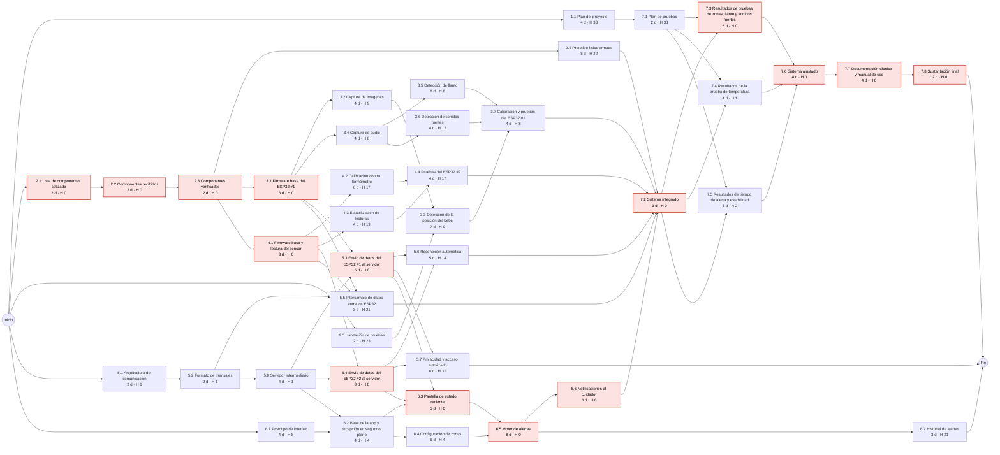
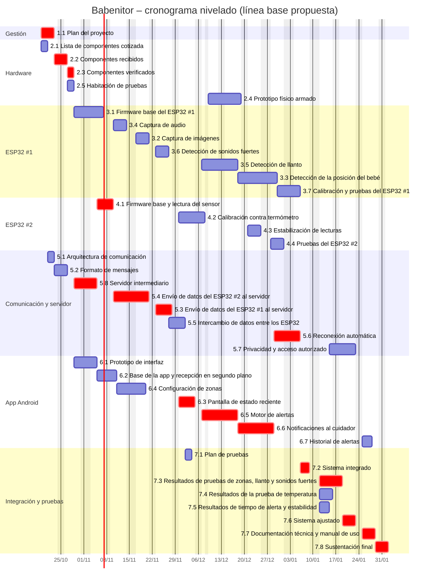

# Cronograma y Ruta Crítica – Babenitor

**Proyecto:** Babenitor – Sistema Inteligente de Monitoreo y Seguridad para Bebés
**Materia:** Gestión de Proyectos de Software
**Fuente:** `Docs/4. EDT.md` (paquetes de trabajo, horas, dependencias y OBS/RACI)
**Estado del documento:** Línea base propuesta (versión 1) – pendiente de aprobación del equipo

---

## Supuestos del cálculo

| Supuesto | Valor | De dónde sale |
| -------- | ----- | ------------- |
| Horas útiles por persona | **2 h por día hábil** (10 h por semana) | La EDT: "unas 10 h semanales por persona" |
| Fórmula de duración | duración = esfuerzo ÷ (personas × 2 h), redondeada hacia arriba | Paso 1 del codelab |
| Días de trabajo | Lunes a viernes, sin festivos de Colombia (02/11, 16/11, 08/12 y 25/12 de 2026; 01/01, 11/01 y 22/03 de 2027) | Calendario |
| Día 0 | **Lunes 19/10/2026** | Fecha en que se arma el cronograma |
| Tipo de dependencia | Fin a comienzo (FC) en todas, sin adelantos ni retrasos | Diccionario de la EDT |
| Esfuerzo recurrente | 1.2, 1.3 y 1.4 (76 h) no entran en la red: se hacen en paralelo durante todo el proyecto | Marcados como [R] o ligados a las entregas en la EDT |

Los días de las tablas son **días hábiles contados desde el día 0**. Un ES de 6 significa que la tarea puede empezar al comenzar el sexto día hábil.

---

## Paso 1 – Lista de tareas

Cada paquete de trabajo de la EDT es una tarea. El nombre, las horas y el criterio de aceptación se heredan tal cual del diccionario. Lo nuevo son las **personas que la realizan** y la **duración**.

Las personas salen de la OBS y la matriz RACI: todos son R en las áreas técnicas, y aquí se fija **quién la hace en este cronograma**. El líder de cada área (la A) está en todas las tareas de su área técnica, y los paquetes de 24 h o más llevan al menos dos personas, como pedía el Paso 2 de la EDT.

| Código | Tarea | Esfuerzo (h) | Personas (R) | N.º | Duración (días hábiles) |
| ------ | ----- | -----------: | ------------ | --: | ----------------------: |
| 1.1 | Plan del proyecto | 16 | Jaime, Dilan | 2 | 4 |
| 2.1 | Lista de componentes cotizada | 8 | Diego, Daniel | 2 | 2 |
| 2.2 | Componentes recibidos | 8 | Daniel, Jaime | 2 | 2 |
| 2.3 | Componentes verificados | 8 | Dilan, Juan José | 2 | 2 |
| 2.4 | Prototipo físico armado | 16 | Daniel | 1 | 8 |
| 2.5 | Habitación de pruebas | 8 | Jaime, Daniel | 2 | 2 |
| 3.1 | Firmware base del ESP32 #1 | 12 | Diego | 1 | 6 |
| 3.2 | Captura de imágenes | 16 | Diego, Dilan | 2 | 4 |
| 3.3 | Detección de la posición del bebé | 40 | Diego, Jaime, Dilan | 3 | 7 |
| 3.4 | Captura de audio | 16 | Diego, Dilan | 2 | 4 |
| 3.5 | Detección de llanto | 32 | Diego, Jaime | 2 | 8 |
| 3.6 | Detección de sonidos fuertes | 8 | Diego | 1 | 4 |
| 3.7 | Calibración y pruebas del ESP32 #1 | 16 | Diego, Jaime | 2 | 4 |
| 4.1 | Firmware base y lectura del sensor | 12 | Daniel, Dilan | 2 | 3 |
| 4.2 | Calibración contra termómetro | 12 | Daniel | 1 | 6 |
| 4.3 | Estabilización de lecturas | 8 | Daniel | 1 | 4 |
| 4.4 | Pruebas del ESP32 #2 | 8 | Daniel | 1 | 4 |
| 5.1 | Arquitectura de comunicación | 8 | Juan José, Daniel | 2 | 2 |
| 5.2 | Formato de mensajes | 8 | Diego, Juan José | 2 | 2 |
| 5.3 | Envío de datos del ESP32 #1 al servidor | 20 | Daniel, Juan José | 2 | 5 |
| 5.4 | Envío de datos del ESP32 #2 al servidor | 16 | Daniel | 1 | 8 |
| 5.5 | Intercambio de datos entre los ESP32 | 12 | Dilan, Diego | 2 | 3 |
| 5.6 | Reconexión automática | 10 | Juan José | 1 | 5 |
| 5.7 | Privacidad y acceso autorizado | 12 | Juan José | 1 | 6 |
| 5.8 | Servidor intermediario | 16 | Dilan, Daniel | 2 | 4 |
| 6.1 | Prototipo de interfaz | 16 | Juan José, Jaime | 2 | 4 |
| 6.2 | Base de la app y recepción en segundo plano | 16 | Juan José, Jaime | 2 | 4 |
| 6.3 | Pantalla de estado reciente | 20 | Juan José, Jaime | 2 | 5 |
| 6.4 | Configuración de zonas | 24 | Juan José, Jaime | 2 | 6 |
| 6.5 | Motor de alertas | 32 | Juan José, Dilan | 2 | 8 |
| 6.6 | Notificaciones al cuidador | 12 | Juan José | 1 | 6 |
| 6.7 | Historial de alertas | 12 | Juan José, Jaime | 2 | 3 |
| 7.1 | Plan de pruebas | 8 | Dilan, Diego | 2 | 2 |
| 7.2 | Sistema integrado | 24 | Diego, Daniel, Juan José, Dilan | 4 | 3 |
| 7.3 | Resultados de pruebas de zonas, llanto y sonidos fuertes | 20 | Daniel, Dilan | 2 | 5 |
| 7.4 | Resultados de la prueba de temperatura | 8 | Diego | 1 | 4 |
| 7.5 | Resultados de tiempo de alerta y estabilidad | 12 | Jaime, Juan José | 2 | 3 |
| 7.6 | Sistema ajustado | 24 | Jaime, Daniel, Dilan | 3 | 4 |
| 7.7 | Documentación técnica y manual de uso | 16 | Diego, Dilan | 2 | 4 |
| 7.8 | Sustentación final | 16 | Juan José, Jaime, Daniel, Diego, Dilan | 5 | 2 |

**Esfuerzo recurrente (fuera de la red):**

| Código | Tarea | Esfuerzo (h) | Personas | Cuándo |
| ------ | ----- | -----------: | -------- | ------ |
| 1.2 | Actas de seguimiento semanal | 40 | Los cinco (Dilan redacta) | Cada semana, del 19/10/2026 al cierre |
| 1.3 | Registro de riesgos y presupuesto | 12 | Dilan | Al cierre de cada mes |
| 1.4 | Informes de entregas parciales | 24 | Dilan, Jaime | Antes de cada entrega parcial que fije el profesor |

**Horas de la red por persona** (sin las recurrentes): Dilan 116 h, Jaime 114 h, Diego 116 h, Juan José 131 h, Daniel 127 h. Suman 606 h; con las 76 h recurrentes se llega a las 682 h de la EDT.

---

## Paso 2 – Las dependencias

Las dependencias son las del diccionario de la EDT ("Depende de"), más una que faltaba. Para cada una se escribe **por qué** existe:

- **Obligatoria:** viene de la naturaleza del trabajo.
- **Decidida:** la eligió el equipo y se puede cambiar si hay que comprimir.
- **Redundante:** ya está incluida a través de otra tarea. No cambia el cálculo, pero sobra en el diagrama.

| Tarea | Depende de | Tipo | Clase | Por qué |
| ----- | ---------- | ---- | ----- | ------- |
| 2.2 Componentes recibidos | 2.1 | FC | Obligatoria | no se compra lo que no está en la lista aprobada |
| 2.3 Componentes verificados | 2.2 | FC | Obligatoria | no se prueba un componente que no ha llegado |
| 2.4 Prototipo físico armado | 2.3 | FC | Obligatoria | no se arma con piezas sin verificar |
| 3.1 Firmware base del ESP32 #1 | 2.3 | FC | Obligatoria | el firmware se carga en un ESP32-CAM que ya enciende y se programa |
| 3.2 Captura de imágenes | 3.1 | FC | Obligatoria | la captura corre sobre el firmware base |
| 3.3 Detección de la posición del bebé | 3.2 | FC | Obligatoria | el algoritmo trabaja sobre las imágenes capturadas |
| 3.3 Detección de la posición del bebé | 2.5 | FC | Obligatoria | el criterio se mide contra las zonas marcadas en la habitación |
| 3.4 Captura de audio | 3.1 | FC | Obligatoria | la captura de audio corre sobre el firmware base |
| 3.4 Captura de audio | 2.3 | FC | Redundante | ya está incluida a través de 3.1 |
| 3.5 Detección de llanto | 3.4 | FC | Obligatoria | el análisis de frecuencia necesita el audio muestreado |
| 3.6 Detección de sonidos fuertes | 3.4 | FC | Obligatoria | el umbral se aplica al volumen que entrega 3.4 |
| 3.7 Calibración y pruebas del ESP32 #1 | 3.3 | FC | Obligatoria | se calibran los tres detectores |
| 3.7 Calibración y pruebas del ESP32 #1 | 3.5 | FC | Obligatoria | ídem |
| 3.7 Calibración y pruebas del ESP32 #1 | 3.6 | FC | Obligatoria | ídem |
| 4.1 Firmware base y lectura del sensor | 2.3 | FC | Obligatoria | el sensor y el ESP32 #2 deben estar verificados |
| 4.2 Calibración contra termómetro | 4.1 | FC | Obligatoria | se calibra una lectura que ya existe |
| 4.3 Estabilización de lecturas | 4.1 | FC | Obligatoria | se filtra una lectura que ya existe |
| 4.4 Pruebas del ESP32 #2 | 4.2 | FC | Obligatoria | se prueba el dispositivo ya calibrado |
| 4.4 Pruebas del ESP32 #2 | 4.3 | FC | Obligatoria | y con la lectura estable |
| 5.2 Formato de mensajes | 5.1 | FC | Obligatoria | los mensajes siguen la arquitectura y el protocolo elegidos |
| 5.3 Envío de datos del ESP32 #1 al servidor | 5.2 | FC | Redundante | ya está incluida a través de 5.8 |
| 5.3 Envío de datos del ESP32 #1 al servidor | 5.8 | FC | Obligatoria | sin servidor no hay a dónde enviar |
| 5.3 Envío de datos del ESP32 #1 al servidor | 3.1 | FC | Obligatoria | el envío corre en el firmware del ESP32 #1 |
| 5.4 Envío de datos del ESP32 #2 al servidor | 5.2 | FC | Redundante | ya está incluida a través de 5.8 |
| 5.4 Envío de datos del ESP32 #2 al servidor | 5.8 | FC | Obligatoria | sin servidor no hay a dónde enviar |
| 5.4 Envío de datos del ESP32 #2 al servidor | 4.1 | FC | Obligatoria | se envía la lectura que produce 4.1 |
| 5.5 Intercambio de datos entre los ESP32 | 5.2 | FC | Obligatoria | los ESP32 intercambian mensajes con el formato acordado |
| 5.5 Intercambio de datos entre los ESP32 | 3.1 | FC | Obligatoria | firmware del ESP32 #1 |
| 5.5 Intercambio de datos entre los ESP32 | 4.1 | FC | Obligatoria | firmware del ESP32 #2 |
| 5.6 Reconexión automática | 5.3 | FC | Obligatoria | se reconecta un envío que ya funciona |
| 5.6 Reconexión automática | 5.4 | FC | Obligatoria | ídem para el ESP32 #2 |
| 5.7 Privacidad y acceso autorizado | 5.3 | FC | Obligatoria | se protege el flujo real de datos |
| 5.7 Privacidad y acceso autorizado | 5.4 | FC | Obligatoria | ídem |
| 5.7 Privacidad y acceso autorizado | 5.8 | FC | Redundante | ya está incluida a través de 5.3 y 5.4 |
| 5.8 Servidor intermediario | 5.1 | FC | Redundante | ya está incluida a través de 5.2 |
| 5.8 Servidor intermediario | 5.2 | FC | Obligatoria | el servidor retransmite los mensajes definidos |
| 6.2 Base de la app y recepción en segundo plano | 6.1 | FC | Decidida | el equipo decidió aprobar las pantallas antes de programar; el proyecto Android podría arrancar antes |
| 6.2 Base de la app y recepción en segundo plano | 5.8 | FC | Obligatoria | la app recibe los datos desde el servidor |
| 6.3 Pantalla de estado reciente | 6.2 | FC | Obligatoria | la pantalla vive en la app base |
| 6.3 Pantalla de estado reciente | 5.3 | FC | Obligatoria | el criterio exige datos reales del servidor, no escritos en el código |
| 6.3 Pantalla de estado reciente | 5.4 | FC | Obligatoria | ídem para la temperatura |
| 6.4 Configuración de zonas | 6.1 | FC | Redundante | ya está incluida a través de 6.2 |
| 6.4 Configuración de zonas | 6.2 | FC | Obligatoria | las zonas se configuran dentro de la app base |
| 6.5 Motor de alertas | 6.3 | FC | Obligatoria | las reglas usan los datos recibidos |
| 6.5 Motor de alertas | 6.4 | FC | Obligatoria | y las zonas configuradas |
| 6.6 Notificaciones al cuidador | 6.5 | FC | Obligatoria | se notifica la alerta que genera el motor |
| 6.7 Historial de alertas | 6.5 | FC | Obligatoria | se guardan las alertas que genera el motor |
| 7.1 Plan de pruebas | 1.1 | FC | Decidida | el plan de pruebas sale de los criterios del acta, que ya existen; se ató al plan por orden del equipo |
| 7.2 Sistema integrado | 3.7 | FC | Obligatoria | se integra el ESP32 #1 ya probado |
| 7.2 Sistema integrado | 4.4 | FC | Obligatoria | el ESP32 #2 ya probado |
| 7.2 Sistema integrado | 5.5 | FC | Obligatoria | el intercambio entre ESP32 |
| 7.2 Sistema integrado | 5.6 | FC | Obligatoria | la reconexión |
| 7.2 Sistema integrado | 6.6 | FC | Obligatoria | y la app que ya notifica |
| 7.2 Sistema integrado | 2.4 | FC | Obligatoria (agregada) | se integra sobre el prototipo físico armado y fijo; agregada en el cronograma, la EDT no la tenía |
| 7.3 Resultados de pruebas de zonas, llanto y sonidos fuertes | 7.1 | FC | Obligatoria | se ejecutan los casos del plan |
| 7.3 Resultados de pruebas de zonas, llanto y sonidos fuertes | 7.2 | FC | Obligatoria | sobre el sistema integrado |
| 7.4 Resultados de la prueba de temperatura | 7.1 | FC | Obligatoria | ídem |
| 7.4 Resultados de la prueba de temperatura | 7.2 | FC | Obligatoria | ídem |
| 7.5 Resultados de tiempo de alerta y estabilidad | 7.1 | FC | Obligatoria | ídem |
| 7.5 Resultados de tiempo de alerta y estabilidad | 7.2 | FC | Obligatoria | ídem |
| 7.6 Sistema ajustado | 7.3 | FC | Obligatoria | se corrige según los resultados |
| 7.6 Sistema ajustado | 7.4 | FC | Obligatoria | ídem |
| 7.6 Sistema ajustado | 7.5 | FC | Obligatoria | ídem |
| 7.7 Documentación técnica y manual de uso | 7.6 | FC | Decidida | se documenta el sistema final; podría empezar antes y terminar junto con 7.6 (fin a fin) |
| 7.8 Sustentación final | 7.6 | FC | Redundante | ya está incluida a través de 7.7 |
| 7.8 Sustentación final | 7.7 | FC | Obligatoria | se sustenta con la documentación entregada |

**Resumen:**

- **Dependencia agregada: 2.4 → 7.2.** En la EDT, *2.4 Prototipo físico armado* no tenía ninguna tarea después. Así, el prototipo podía armarse después de la integración. Hay que agregarla también en el diccionario de la EDT (punto a revisar 4).
- **Decididas (3):** 6.1 → 6.2, 1.1 → 7.1 y 7.6 → 7.7. Son las primeras candidatas si hay que comprimir (Paso 7).
- **Redundantes (7):** no se dibujan en el diagrama de red. Conviene quitarlas del diccionario para que la EDT quede limpia.

### Diagrama de red

Cada nodo muestra la duración (d) y la holgura (H). En rojo, las tareas críticas. No se dibujan las dependencias redundantes.



---

## Paso 3 – El recorrido hacia adelante

Para cada tarea, en orden: **ES** (inicio más temprano) = el mayor EF de sus predecesoras (0 si no tiene) y **EF** (fin más temprano) = ES + duración.

El mayor EF es **54 días hábiles**: es la duración mínima del proyecto con recursos ilimitados. Contando desde el 19/10/2026, termina el **07/01/2027**.

## Paso 4 – El recorrido hacia atrás y la holgura

En orden inverso, empezando con LF = 54 en las tareas que no tienen sucesoras: **LF** (fin más tardío) = el menor LS de sus sucesoras y **LS** (inicio más tardío) = LF − duración. Luego, **holgura = LS − ES**.

| Código | Tarea | Dur. | ES | EF | LS | LF | Holgura | Crítica |
| ------ | ----- | ---: | -: | -: | -: | -: | ------: | :-----: |
| 1.1 | Plan del proyecto | 4 | 0 | 4 | 33 | 37 | 33 |  |
| 2.1 | Lista de componentes cotizada | 2 | 0 | 2 | 0 | 2 | 0 | **Sí** |
| 2.5 | Habitación de pruebas | 2 | 0 | 2 | 23 | 25 | 23 |  |
| 5.1 | Arquitectura de comunicación | 2 | 0 | 2 | 1 | 3 | 1 |  |
| 6.1 | Prototipo de interfaz | 4 | 0 | 4 | 8 | 12 | 8 |  |
| 2.2 | Componentes recibidos | 2 | 2 | 4 | 2 | 4 | 0 | **Sí** |
| 5.2 | Formato de mensajes | 2 | 2 | 4 | 3 | 5 | 1 |  |
| 2.3 | Componentes verificados | 2 | 4 | 6 | 4 | 6 | 0 | **Sí** |
| 5.8 | Servidor intermediario | 4 | 4 | 8 | 5 | 9 | 1 |  |
| 7.1 | Plan de pruebas | 2 | 4 | 6 | 37 | 39 | 33 |  |
| 2.4 | Prototipo físico armado | 8 | 6 | 14 | 28 | 36 | 22 |  |
| 3.1 | Firmware base del ESP32 #1 | 6 | 6 | 12 | 6 | 12 | 0 | **Sí** |
| 4.1 | Firmware base y lectura del sensor | 3 | 6 | 9 | 6 | 9 | 0 | **Sí** |
| 6.2 | Base de la app y recepción en segundo plano | 4 | 8 | 12 | 12 | 16 | 4 |  |
| 4.2 | Calibración contra termómetro | 6 | 9 | 15 | 26 | 32 | 17 |  |
| 4.3 | Estabilización de lecturas | 4 | 9 | 13 | 28 | 32 | 19 |  |
| 5.4 | Envío de datos del ESP32 #2 al servidor | 8 | 9 | 17 | 9 | 17 | 0 | **Sí** |
| 3.2 | Captura de imágenes | 4 | 12 | 16 | 21 | 25 | 9 |  |
| 3.4 | Captura de audio | 4 | 12 | 16 | 20 | 24 | 8 |  |
| 5.3 | Envío de datos del ESP32 #1 al servidor | 5 | 12 | 17 | 12 | 17 | 0 | **Sí** |
| 5.5 | Intercambio de datos entre los ESP32 | 3 | 12 | 15 | 33 | 36 | 21 |  |
| 6.4 | Configuración de zonas | 6 | 12 | 18 | 16 | 22 | 4 |  |
| 4.4 | Pruebas del ESP32 #2 | 4 | 15 | 19 | 32 | 36 | 17 |  |
| 3.3 | Detección de la posición del bebé | 7 | 16 | 23 | 25 | 32 | 9 |  |
| 3.5 | Detección de llanto | 8 | 16 | 24 | 24 | 32 | 8 |  |
| 3.6 | Detección de sonidos fuertes | 4 | 16 | 20 | 28 | 32 | 12 |  |
| 5.6 | Reconexión automática | 5 | 17 | 22 | 31 | 36 | 14 |  |
| 5.7 | Privacidad y acceso autorizado | 6 | 17 | 23 | 48 | 54 | 31 |  |
| 6.3 | Pantalla de estado reciente | 5 | 17 | 22 | 17 | 22 | 0 | **Sí** |
| 6.5 | Motor de alertas | 8 | 22 | 30 | 22 | 30 | 0 | **Sí** |
| 3.7 | Calibración y pruebas del ESP32 #1 | 4 | 24 | 28 | 32 | 36 | 8 |  |
| 6.6 | Notificaciones al cuidador | 6 | 30 | 36 | 30 | 36 | 0 | **Sí** |
| 6.7 | Historial de alertas | 3 | 30 | 33 | 51 | 54 | 21 |  |
| 7.2 | Sistema integrado | 3 | 36 | 39 | 36 | 39 | 0 | **Sí** |
| 7.3 | Resultados de pruebas de zonas, llanto y sonidos fuertes | 5 | 39 | 44 | 39 | 44 | 0 | **Sí** |
| 7.4 | Resultados de la prueba de temperatura | 4 | 39 | 43 | 40 | 44 | 1 |  |
| 7.5 | Resultados de tiempo de alerta y estabilidad | 3 | 39 | 42 | 41 | 44 | 2 |  |
| 7.6 | Sistema ajustado | 4 | 44 | 48 | 44 | 48 | 0 | **Sí** |
| 7.7 | Documentación técnica y manual de uso | 4 | 48 | 52 | 48 | 52 | 0 | **Sí** |
| 7.8 | Sustentación final | 2 | 52 | 54 | 52 | 54 | 0 | **Sí** |

---

## Paso 5 – La ruta crítica

Las tareas con holgura cero forman un camino continuo del principio al fin, con un tramo doble entre 2.3 y 6.3:

```
2.1 → 2.2 → 2.3 ─┬→ 3.1 → 5.3 ─┬→ 6.3 → 6.5 → 6.6 → 7.2 → 7.3 → 7.6 → 7.7 → 7.8
                 └→ 4.1 → 5.4 ─┘
```

**Comprobación:** 2.1 (2) + 2.2 (2) + 2.3 (2) + 4.1 (3) + 5.4 (8) + 6.3 (5) + 6.5 (8) + 6.6 (6) + 7.2 (3) + 7.3 (5) + 7.6 (4) + 7.7 (4) + 7.8 (2) = **54 días**, igual a la duración del proyecto. La rama 3.1 (6) + 5.3 (5) suma 11, lo mismo que 4.1 (3) + 5.4 (8), y por eso las dos ramas son críticas.

**Lectura:**

- La ruta crítica pasa por **el hardware, el envío de datos al servidor, la app y las pruebas finales**. Un día de atraso en cualquiera de esas 15 tareas atrasa la entrega un día.
- **Casi críticas:** 5.1, 5.2, 5.8 y 7.4 (1 día de holgura) y 7.5 (2 días). Cualquier imprevisto las vuelve críticas.
- La detección de posición y de llanto (3.3 y 3.5), el riesgo técnico principal del acta, **no** son críticas en tiempo: tienen 9 y 8 días de holgura. Ese margen se puede usar si la calibración se complica.
- Recortar **6.7 Historial** o **5.7 Privacidad** no adelanta la fecha: tienen 21 y 31 días de holgura.

---

## Paso 6 – El cronograma contra el equipo real

La ruta crítica de 54 días supone que siempre hay alguien libre para cada tarea. Con los cinco integrantes, varias tareas se cruzan en la misma persona. Se resolvió así:

1. Las tareas se programan en orden de **menor LS** (primero la que menos margen tiene). El plan del proyecto (1.1) se fija al inicio porque es la base del resto.
2. Si alguna de sus personas está ocupada, la tarea se mueve al primer día en que **todas** estén libres. Primero se consume su holgura; cuando no alcanza, se acepta el atraso.
3. El reparto de personas se eligió probando combinaciones y quedándose con la que da la fecha más temprana. Como reglas: el líder en todas las tareas de su área y ninguna persona por fuera de unas 105–135 h de red.

**Resultado:** con el equipo real el proyecto dura **70 días hábiles** y termina el **01/02/2027**. Son 16 días más que la ruta crítica sin recursos, porque esa cifra es un **piso**, no una promesa.

**Cadena que fija la fecha con recursos** (cada tarea empieza justo cuando termina la anterior, por dependencia o porque es la misma persona):

1. 1.1 Plan del proyecto (Jaime, Dilan): 19/10/2026 – 22/10/2026
2. 2.2 Componentes recibidos (Daniel, Jaime): 23/10/2026 – 26/10/2026
3. 2.3 Componentes verificados (Dilan, Juan José): 27/10/2026 – 28/10/2026
4. 5.8 Servidor intermediario (Dilan, Daniel): 29/10/2026 – 04/11/2026
5. 4.1 Firmware base y lectura del sensor (Daniel, Dilan): 05/11/2026 – 09/11/2026
6. 5.4 Envío de datos del ESP32 #2 al servidor (Daniel): 10/11/2026 – 20/11/2026
7. 5.3 Envío de datos del ESP32 #1 al servidor (Daniel, Juan José): 23/11/2026 – 27/11/2026
8. 6.3 Pantalla de estado reciente (Juan José, Jaime): 30/11/2026 – 04/12/2026
9. 6.5 Motor de alertas (Juan José, Dilan): 07/12/2026 – 17/12/2026
10. 6.6 Notificaciones al cuidador (Juan José): 18/12/2026 – 28/12/2026
11. 5.6 Reconexión automática (Juan José): 29/12/2026 – 05/01/2027
12. 7.2 Sistema integrado (Diego, Daniel, Juan José, Dilan): 06/01/2027 – 08/01/2027
13. 7.3 Resultados de pruebas de zonas, llanto y sonidos fuertes (Daniel, Dilan): 12/01/2027 – 18/01/2027
14. 7.6 Sistema ajustado (Jaime, Daniel, Dilan): 19/01/2027 – 22/01/2027
15. 7.7 Documentación técnica y manual de uso (Diego, Dilan): 25/01/2027 – 28/01/2027
16. 7.8 Sustentación final (Juan José, Jaime, Daniel, Diego, Dilan): 29/01/2027 – 01/02/2027

### Cronograma nivelado

| Código | Tarea | Personas | Inicio | Fin | Días |
| ------ | ----- | -------- | ------ | --- | ---: |
| 1.1 | Plan del proyecto | Jaime, Dilan | 19/10/2026 | 22/10/2026 | 4 |
| 2.1 | Lista de componentes cotizada | Diego, Daniel | 19/10/2026 | 20/10/2026 | 2 |
| 5.1 | Arquitectura de comunicación | Juan José, Daniel | 21/10/2026 | 22/10/2026 | 2 |
| 2.2 | Componentes recibidos | Daniel, Jaime | 23/10/2026 | 26/10/2026 | 2 |
| 5.2 | Formato de mensajes | Diego, Juan José | 23/10/2026 | 26/10/2026 | 2 |
| 2.3 | Componentes verificados | Dilan, Juan José | 27/10/2026 | 28/10/2026 | 2 |
| 2.5 | Habitación de pruebas | Jaime, Daniel | 27/10/2026 | 28/10/2026 | 2 |
| 3.1 | Firmware base del ESP32 #1 | Diego | 29/10/2026 | 06/11/2026 | 6 |
| 5.8 | Servidor intermediario | Dilan, Daniel | 29/10/2026 | 04/11/2026 | 4 |
| 6.1 | Prototipo de interfaz | Juan José, Jaime | 29/10/2026 | 04/11/2026 | 4 |
| 4.1 | Firmware base y lectura del sensor | Daniel, Dilan | 05/11/2026 | 09/11/2026 | 3 |
| 6.2 | Base de la app y recepción en segundo plano | Juan José, Jaime | 05/11/2026 | 10/11/2026 | 4 |
| 3.4 | Captura de audio | Diego, Dilan | 10/11/2026 | 13/11/2026 | 4 |
| 5.4 | Envío de datos del ESP32 #2 al servidor | Daniel | 10/11/2026 | 20/11/2026 | 8 |
| 6.4 | Configuración de zonas | Juan José, Jaime | 11/11/2026 | 19/11/2026 | 6 |
| 3.2 | Captura de imágenes | Diego, Dilan | 17/11/2026 | 20/11/2026 | 4 |
| 3.6 | Detección de sonidos fuertes | Diego | 23/11/2026 | 26/11/2026 | 4 |
| 5.3 | Envío de datos del ESP32 #1 al servidor | Daniel, Juan José | 23/11/2026 | 27/11/2026 | 5 |
| 5.5 | Intercambio de datos entre los ESP32 | Dilan, Diego | 27/11/2026 | 01/12/2026 | 3 |
| 4.2 | Calibración contra termómetro | Daniel | 30/11/2026 | 07/12/2026 | 6 |
| 6.3 | Pantalla de estado reciente | Juan José, Jaime | 30/11/2026 | 04/12/2026 | 5 |
| 7.1 | Plan de pruebas | Dilan, Diego | 02/12/2026 | 03/12/2026 | 2 |
| 3.5 | Detección de llanto | Diego, Jaime | 07/12/2026 | 17/12/2026 | 8 |
| 6.5 | Motor de alertas | Juan José, Dilan | 07/12/2026 | 17/12/2026 | 8 |
| 2.4 | Prototipo físico armado | Daniel | 09/12/2026 | 18/12/2026 | 8 |
| 3.3 | Detección de la posición del bebé | Diego, Jaime, Dilan | 18/12/2026 | 29/12/2026 | 7 |
| 6.6 | Notificaciones al cuidador | Juan José | 18/12/2026 | 28/12/2026 | 6 |
| 4.3 | Estabilización de lecturas | Daniel | 21/12/2026 | 24/12/2026 | 4 |
| 4.4 | Pruebas del ESP32 #2 | Daniel | 28/12/2026 | 31/12/2026 | 4 |
| 5.6 | Reconexión automática | Juan José | 29/12/2026 | 05/01/2027 | 5 |
| 3.7 | Calibración y pruebas del ESP32 #1 | Diego, Jaime | 30/12/2026 | 05/01/2027 | 4 |
| 7.2 | Sistema integrado | Diego, Daniel, Juan José, Dilan | 06/01/2027 | 08/01/2027 | 3 |
| 7.3 | Resultados de pruebas de zonas, llanto y sonidos fuertes | Daniel, Dilan | 12/01/2027 | 18/01/2027 | 5 |
| 7.4 | Resultados de la prueba de temperatura | Diego | 12/01/2027 | 15/01/2027 | 4 |
| 7.5 | Resultados de tiempo de alerta y estabilidad | Jaime, Juan José | 12/01/2027 | 14/01/2027 | 3 |
| 5.7 | Privacidad y acceso autorizado | Juan José | 15/01/2027 | 22/01/2027 | 6 |
| 7.6 | Sistema ajustado | Jaime, Daniel, Dilan | 19/01/2027 | 22/01/2027 | 4 |
| 6.7 | Historial de alertas | Juan José, Jaime | 25/01/2027 | 27/01/2027 | 3 |
| 7.7 | Documentación técnica y manual de uso | Diego, Dilan | 25/01/2027 | 28/01/2027 | 4 |
| 7.8 | Sustentación final | Juan José, Jaime, Daniel, Diego, Dilan | 29/01/2027 | 01/02/2027 | 2 |

### Calendario de cada persona

Verificado: **nadie está en dos tareas el mismo día.**

**Dilan** (117 h de tareas de la red)

| Tarea | Inicio | Fin |
| ----- | ------ | --- |
| 1.1 Plan del proyecto | 19/10/2026 | 22/10/2026 |
| 2.3 Componentes verificados | 27/10/2026 | 28/10/2026 |
| 5.8 Servidor intermediario | 29/10/2026 | 04/11/2026 |
| 4.1 Firmware base y lectura del sensor | 05/11/2026 | 09/11/2026 |
| 3.4 Captura de audio | 10/11/2026 | 13/11/2026 |
| 3.2 Captura de imágenes | 17/11/2026 | 20/11/2026 |
| 5.5 Intercambio de datos entre los ESP32 | 27/11/2026 | 01/12/2026 |
| 7.1 Plan de pruebas | 02/12/2026 | 03/12/2026 |
| 6.5 Motor de alertas | 07/12/2026 | 17/12/2026 |
| 3.3 Detección de la posición del bebé | 18/12/2026 | 29/12/2026 |
| 7.2 Sistema integrado | 06/01/2027 | 08/01/2027 |
| 7.3 Resultados de pruebas de zonas, llanto y sonidos fuertes | 12/01/2027 | 18/01/2027 |
| 7.6 Sistema ajustado | 19/01/2027 | 22/01/2027 |
| 7.7 Documentación técnica y manual de uso | 25/01/2027 | 28/01/2027 |
| 7.8 Sustentación final | 29/01/2027 | 01/02/2027 |

**Jaime** (115 h de tareas de la red)

| Tarea | Inicio | Fin |
| ----- | ------ | --- |
| 1.1 Plan del proyecto | 19/10/2026 | 22/10/2026 |
| 2.2 Componentes recibidos | 23/10/2026 | 26/10/2026 |
| 2.5 Habitación de pruebas | 27/10/2026 | 28/10/2026 |
| 6.1 Prototipo de interfaz | 29/10/2026 | 04/11/2026 |
| 6.2 Base de la app y recepción en segundo plano | 05/11/2026 | 10/11/2026 |
| 6.4 Configuración de zonas | 11/11/2026 | 19/11/2026 |
| 6.3 Pantalla de estado reciente | 30/11/2026 | 04/12/2026 |
| 3.5 Detección de llanto | 07/12/2026 | 17/12/2026 |
| 3.3 Detección de la posición del bebé | 18/12/2026 | 29/12/2026 |
| 3.7 Calibración y pruebas del ESP32 #1 | 30/12/2026 | 05/01/2027 |
| 7.5 Resultados de tiempo de alerta y estabilidad | 12/01/2027 | 14/01/2027 |
| 7.6 Sistema ajustado | 19/01/2027 | 22/01/2027 |
| 6.7 Historial de alertas | 25/01/2027 | 27/01/2027 |
| 7.8 Sustentación final | 29/01/2027 | 01/02/2027 |

**Diego** (117 h de tareas de la red)

| Tarea | Inicio | Fin |
| ----- | ------ | --- |
| 2.1 Lista de componentes cotizada | 19/10/2026 | 20/10/2026 |
| 5.2 Formato de mensajes | 23/10/2026 | 26/10/2026 |
| 3.1 Firmware base del ESP32 #1 | 29/10/2026 | 06/11/2026 |
| 3.4 Captura de audio | 10/11/2026 | 13/11/2026 |
| 3.2 Captura de imágenes | 17/11/2026 | 20/11/2026 |
| 3.6 Detección de sonidos fuertes | 23/11/2026 | 26/11/2026 |
| 5.5 Intercambio de datos entre los ESP32 | 27/11/2026 | 01/12/2026 |
| 7.1 Plan de pruebas | 02/12/2026 | 03/12/2026 |
| 3.5 Detección de llanto | 07/12/2026 | 17/12/2026 |
| 3.3 Detección de la posición del bebé | 18/12/2026 | 29/12/2026 |
| 3.7 Calibración y pruebas del ESP32 #1 | 30/12/2026 | 05/01/2027 |
| 7.2 Sistema integrado | 06/01/2027 | 08/01/2027 |
| 7.4 Resultados de la prueba de temperatura | 12/01/2027 | 15/01/2027 |
| 7.7 Documentación técnica y manual de uso | 25/01/2027 | 28/01/2027 |
| 7.8 Sustentación final | 29/01/2027 | 01/02/2027 |

**Juan José** (131 h de tareas de la red)

| Tarea | Inicio | Fin |
| ----- | ------ | --- |
| 5.1 Arquitectura de comunicación | 21/10/2026 | 22/10/2026 |
| 5.2 Formato de mensajes | 23/10/2026 | 26/10/2026 |
| 2.3 Componentes verificados | 27/10/2026 | 28/10/2026 |
| 6.1 Prototipo de interfaz | 29/10/2026 | 04/11/2026 |
| 6.2 Base de la app y recepción en segundo plano | 05/11/2026 | 10/11/2026 |
| 6.4 Configuración de zonas | 11/11/2026 | 19/11/2026 |
| 5.3 Envío de datos del ESP32 #1 al servidor | 23/11/2026 | 27/11/2026 |
| 6.3 Pantalla de estado reciente | 30/11/2026 | 04/12/2026 |
| 6.5 Motor de alertas | 07/12/2026 | 17/12/2026 |
| 6.6 Notificaciones al cuidador | 18/12/2026 | 28/12/2026 |
| 5.6 Reconexión automática | 29/12/2026 | 05/01/2027 |
| 7.2 Sistema integrado | 06/01/2027 | 08/01/2027 |
| 7.5 Resultados de tiempo de alerta y estabilidad | 12/01/2027 | 14/01/2027 |
| 5.7 Privacidad y acceso autorizado | 15/01/2027 | 22/01/2027 |
| 6.7 Historial de alertas | 25/01/2027 | 27/01/2027 |
| 7.8 Sustentación final | 29/01/2027 | 01/02/2027 |

**Daniel** (127 h de tareas de la red)

| Tarea | Inicio | Fin |
| ----- | ------ | --- |
| 2.1 Lista de componentes cotizada | 19/10/2026 | 20/10/2026 |
| 5.1 Arquitectura de comunicación | 21/10/2026 | 22/10/2026 |
| 2.2 Componentes recibidos | 23/10/2026 | 26/10/2026 |
| 2.5 Habitación de pruebas | 27/10/2026 | 28/10/2026 |
| 5.8 Servidor intermediario | 29/10/2026 | 04/11/2026 |
| 4.1 Firmware base y lectura del sensor | 05/11/2026 | 09/11/2026 |
| 5.4 Envío de datos del ESP32 #2 al servidor | 10/11/2026 | 20/11/2026 |
| 5.3 Envío de datos del ESP32 #1 al servidor | 23/11/2026 | 27/11/2026 |
| 4.2 Calibración contra termómetro | 30/11/2026 | 07/12/2026 |
| 2.4 Prototipo físico armado | 09/12/2026 | 18/12/2026 |
| 4.3 Estabilización de lecturas | 21/12/2026 | 24/12/2026 |
| 4.4 Pruebas del ESP32 #2 | 28/12/2026 | 31/12/2026 |
| 7.2 Sistema integrado | 06/01/2027 | 08/01/2027 |
| 7.3 Resultados de pruebas de zonas, llanto y sonidos fuertes | 12/01/2027 | 18/01/2027 |
| 7.6 Sistema ajustado | 19/01/2027 | 22/01/2027 |
| 7.8 Sustentación final | 29/01/2027 | 01/02/2027 |


### Diagrama de Gantt

En rojo, la cadena que fija la fecha con recursos.



---

## Paso 7 – Comprimir el cronograma

La fecha calculada no coincide con los hitos del acta:

| Hito del acta | Fecha del acta | Fecha calculada | Diferencia |
| ------------- | -------------- | --------------- | ---------- |
| Diseño del prototipo (componentes, arquitectura, diseño de la app) | 20/10/2026 | 04/11/2026 (fin de 6.1) | 10 días hábiles tarde |
| Integración de ESP32 + sensores (ambos ESP32 capturan y se comunican) | 10/11/2026 | 01/12/2026 (fin de 5.5) | 14 días hábiles tarde |
| Primera versión funcional (sistema completo con alertas en la app) | 01/12/2026 | 08/01/2027 (fin de 7.2) | 25 días hábiles tarde |

Incluso sin límite de personas, 7.2 no termina antes del 15/12/2026. **Con 10 h semanales, el hito del 01/12 no se puede cumplir.** Opciones (las decide el equipo, no este documento):

| Opción | Qué implica | Efecto |
| ------ | ----------- | ------ |
| **Más horas por semana** (compresión por recursos) | Subir la dedicación, sobre todo en las tareas de la ruta crítica | Con 15 h/semana: piso de 42 días (18/12/2026) y fin real el 08/01/2027. Con 20 h/semana: piso de 29 días (30/11/2026) y fin real el 14/12/2026 |
| **Ejecución en paralelo** | Empezar 6.3 con datos simulados que siguen el formato de 5.2, sin esperar a 5.3 y 5.4; empezar 7.7 durante 7.6 (es una dependencia decidida) | No cuesta dinero, cuesta riesgo: si el formato cambia, hay retrabajo en la app |
| **Cambio de alcance** | Solo con aprobación del profesor y registrado como cambio | Solo sirve si se recorta algo **crítico**. Recortar 6.7 o 5.7 no adelanta nada |

**El límite:** comprimir la ruta crítica solo sirve hasta que otro camino se vuelve el más largo. Las tareas con 1 o 2 días de holgura (5.1, 5.2, 5.8, 7.4 y 7.5) se vuelven críticas apenas se recorta más de eso. Para bajar más hay que acortarlas también.

---

## Paso 8 – Hitos y línea base

### Hitos

Duración cero; cada uno se cumple cuando termina la tarea indicada y se cumple su criterio de aceptación.

| Hito | Se cumple cuando | Fecha (línea base) |
| ---- | ---------------- | ------------------ |
| H0 – Inicio del proyecto | Acta aprobada | 22/09/2026 (cumplido) |
| H1 – Plan del proyecto entregado | Termina 1.1 (EDT, OBS y cronograma) | 22/10/2026 |
| H2 – Hardware verificado | Termina 2.3 | 28/10/2026 |
| H3 – Diseño del prototipo listo | Terminan 5.1, 5.2 y 6.1 | 04/11/2026 |
| H4 – ESP32 integrados | Terminan 3.2, 3.4, 4.1 y 5.5 | 01/12/2026 |
| H5 – Primera versión funcional | Termina 7.2 | 08/01/2027 |
| H6 – Criterios de éxito verificados | Termina 7.6 | 22/01/2027 |
| H7 – Sustentación final | Termina 7.8 | 01/02/2027 (fecha real por confirmar con el profesor) |

### Línea base

Este documento es la **versión 1** del cronograma. Cuando el equipo lo apruebe, se congela como línea base y el seguimiento semanal (1.2) compara contra ella. Si la línea base cambia, se registra aquí con su razón; no se mueve en silencio.

| Versión | Fecha | Cambio | Razón | Aprobado por |
| ------- | ----- | ------ | ----- | ------------ |
| 1 | 19/10/2026 | Cronograma inicial | — | Pendiente |

---

## Verificación

| Pregunta | Respuesta |
| -------- | --------- |
| ¿Cada paquete de trabajo es una tarea con duración calculada? | **Sí.** Los 40 paquetes de la red tienen duración = esfuerzo ÷ (personas × 2 h); los 3 recurrentes van aparte. |
| ¿Cada dependencia tiene su porqué? | **Sí.** Clasificadas como obligatorias, decididas o redundantes. |
| ¿Se hicieron los dos recorridos y la holgura de cada tarea? | **Sí.** Tabla del Paso 4. |
| ¿La ruta crítica es continua y suma la duración del proyecto? | **Sí.** 54 días por las dos ramas. |
| ¿Nadie está en dos tareas a la vez? | **Sí.** Verificado persona por persona en el Paso 6. |
| ¿Hay al menos tres hitos verificables? | **Sí.** Ocho, del H0 al H7. |
| ¿Está en el repositorio como versión aprobada? | **En proceso.** Está en `Docs/5. Cronograma.md`; falta la aprobación del equipo. |

---

## Puntos a revisar

1. **Horas por semana.** Todo el cronograma depende de las 10 h semanales por persona de la EDT. Si el equipo puede dedicar más, se recalcula (ver Paso 7).
2. **Hitos del acta.** Las fechas del 20/10, 10/11 y 01/12 no se cumplen con esta capacidad. Hay que decidir entre comprimir o actualizar los hitos con un cambio registrado y avisar al profesor.
3. **Vacaciones de fin de año.** El cálculo trabaja todos los días hábiles de diciembre y enero. Si el equipo no trabaja en vacaciones, la fecha se corre.
4. **EDT.** Agregar 2.4 en "Depende de" de 7.2 y quitar las dependencias redundantes del diccionario.
5. **Reparto de personas.** Cada integrante debe revisar su calendario (Paso 6) y confirmar que puede cumplirlo.
6. **Fecha de la sustentación.** Sigue por confirmar; el cronograma calcula el 01/02/2027.
