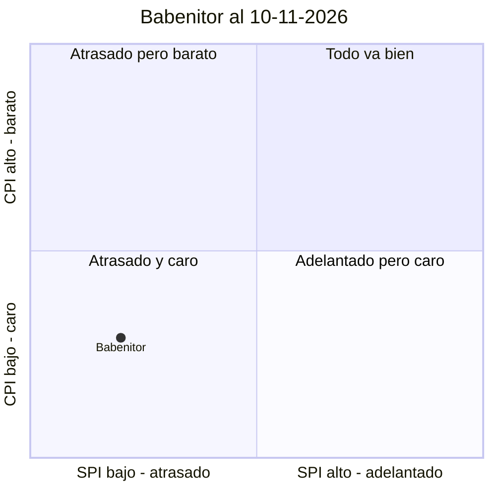
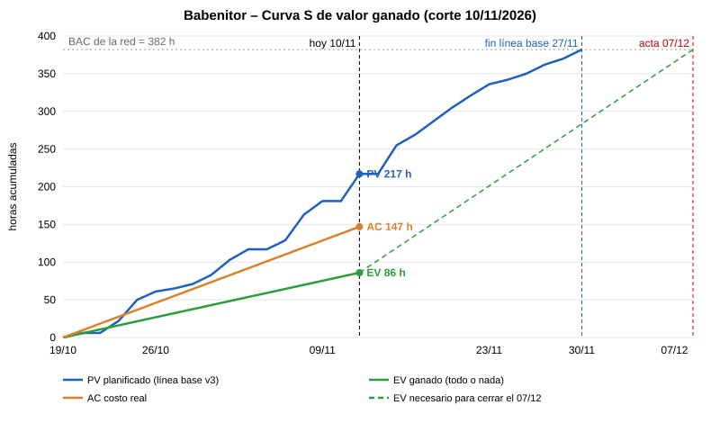

# Seguimiento y Métricas – Babenitor

**Proyecto:** Babenitor – Sistema Inteligente de Monitoreo y Seguridad para Bebés
**Fuentes:** `Docs/4. EDT.md` (alcance y criterios de aceptación), `Docs/5. Cronograma.md` (fechas de la línea base), `Docs/7. Estimación.md` (horas por paquete), `Docs/6. Presupuesto.md` (valor de la hora), `Docs/ev10-11-2026.md` (estado real de los paquetes)
**Fecha de corte:** 10/11/2026
**Estado del documento:** Versión 1. Primer corte de valor ganado.

---

## Decisiones y datos de entrada

| Dato | Valor | Origen |
| ---- | ----- | ------ |
| Regla de avance | **Todo o nada**: 0 % hasta cumplir el criterio de aceptación de la EDT y 100 % cuando se cumple | Codelab; decisión del equipo |
| Paquetes medidos | Los **38 paquetes de la red** del cronograma (382 h). 1.2, 1.3 y 1.4 (28 h, recurrentes) quedan fuera del PV y del EV | Decisión del equipo |
| 6.3 Pantalla de estado reciente | **Vale 0 %.** La pantalla existe, pero su criterio exige datos del servidor y sus predecesoras obligatorias (5.3, 5.4 y 6.2) no están hechas | Decisión del equipo |
| Valor de la hora | $8.338 | Presupuesto, sección 4 |
| Costo real (AC) | **147 h** (sección 3.3) | Horas dedicadas por el equipo entre el 19/10 y el 10/11 |
| Línea base | Cronograma y EDT **versión 3, congelados el 10/11/2026** | Decisión del equipo |
| Responsable de actualizar los números | **Jaime**, cada viernes | Decisión del equipo |

---

## 1. Para qué se mide

Se mide para poder corregir mientras todavía hay margen. Al 10/11/2026 quedan **18 días hábiles** hasta el 07/12/2026, la fecha de fin del acta. Cada métrica de este documento tiene escrita la decisión que habilita (sección 5). Las que no habilitaban ninguna decisión se dejaron fuera (sección 5.2).

---

## 2. La línea base

| Componente | De dónde sale | Contenido |
| ---------- | ------------- | --------- |
| Línea base de alcance | EDT v3 y su diccionario | 41 paquetes, 410 h, cada uno con su criterio de aceptación |
| Línea base de tiempo | Cronograma nivelado v3 | 38 paquetes con fecha de inicio y de fin, del 19/10/2026 al 27/11/2026 |
| Línea base de costo | Estimación v1 (horas por paquete) × $8.338 por hora | 410 h = $3.418.580 de mano de obra; la red mide 382 h = $3.185.116 |

**Congelada el 10/11/2026 por el equipo** (registrada en el Paso 8 del cronograma).

**Regla:** la línea base solo cambia si se aprueba un cambio de alcance por control de cambios. Ese cambio se registra en el cronograma con su razón, quién lo aprobó y qué se recortó a cambio. **No se mueve porque el proyecto se atrase.** Por eso la decisión de la sección 4.3 (entregar el 07/12) **no cambia la línea base**: el SPI se sigue midiendo contra el plan v3 que termina el 27/11.

### Valor planificado acumulado de la línea base (PV)

Con la misma regla de todo o nada, el valor de cada paquete se cuenta en su fecha de fin planificada:

| Corte (fin del día) | PV acumulado | % de la red (382 h) |
| ------------------- | -----------: | ------------------: |
| Vie 23/10/2026 | 61 h | 16,0 % |
| Vie 30/10/2026 | 117 h | 30,6 % |
| Vie 06/11/2026 | 181 h | 47,4 % |
| **Mar 10/11/2026 (hoy)** | **217 h** | **56,8 %** |
| Vie 13/11/2026 | 269 h | 70,4 % |
| Vie 20/11/2026 | 336 h | 88,0 % |
| Vie 27/11/2026 | 382 h | 100,0 % |

---

## 3. Valor ganado al 10/11/2026

### 3.1 Valor planificado (PV): lo que debía estar terminado

23 paquetes tienen fecha de fin igual o anterior al 10/11/2026:

| Paquete | h | Fin planificado | ¿Terminado? |
| ------- | -: | --------------- | :---------: |
| 1.1 Plan del proyecto | 16 | 22/10 | Sí |
| 5.1 Arquitectura de comunicación | 6 | 19/10 | No |
| 5.2 Formato de mensajes | 6 | 21/10 | No |
| 6.1 Prototipo de interfaz | 10 | 21/10 | Sí |
| 5.8 Servidor intermediario | 12 | 22/10 | No |
| 2.1 Lista de componentes cotizada | 4 | 23/10 | Sí |
| 7.1 Plan de pruebas | 7 | 23/10 | No |
| 2.2 Componentes recibidos | 4 | 26/10 | Sí |
| 2.3 Componentes verificados | 6 | 27/10 | Sí |
| 2.5 Habitación de pruebas | 4 | 28/10 | No |
| 3.1 Firmware base del ESP32 #1 | 8 | 28/10 | Sí |
| 4.1 Firmware base y lectura del sensor | 8 | 29/10 | Sí |
| 6.2 Base de la app y recepción en segundo plano | 12 | 29/10 | No |
| 3.2 Captura de imágenes | 10 | 30/10 | Sí |
| 4.3 Estabilización de lecturas | 4 | 30/10 | No |
| 6.4 Configuración de zonas | 14 | 05/11 | No |
| 3.3 Detección de la posición del bebé | 20 | 05/11 | No |
| 5.3 Envío de datos del ESP32 #1 al servidor | 12 | 04/11 | No |
| 3.4 Captura de audio | 10 | 06/11 | Sí |
| 5.4 Envío de datos del ESP32 #2 al servidor | 8 | 06/11 | No |
| 3.8 Detección de movimiento anormal | 16 | 10/11 | No |
| 5.5 Intercambio de datos entre los ESP32 | 8 | 10/11 | No |
| 6.3 Pantalla de estado reciente | 12 | 10/11 | No (en curso) |
| **PV** | **217** | | |

### 3.2 Valor ganado (EV): lo terminado de verdad

| Paquete | h |
| ------- | -: |
| 1.1 Plan del proyecto | 16 |
| 2.1 Lista de componentes cotizada | 4 |
| 2.2 Componentes recibidos | 4 |
| 2.3 Componentes verificados | 6 |
| 3.1 Firmware base del ESP32 #1 | 8 |
| 3.2 Captura de imágenes | 10 |
| 3.4 Captura de audio | 10 |
| 4.1 Firmware base y lectura del sensor | 8 |
| 4.2 Calibración contra termómetro (adelantado: planificado el 17/11) | 10 |
| 6.1 Prototipo de interfaz | 10 |
| **EV** | **86** |

**Atrasados:** 14 paquetes que debían estar terminados no lo están, con **141 h** en total (217 − 76). Hay un solo adelanto: 4.2 (10 h).

**Bloque más atrasado:** 5.0 Comunicación tiene **0 h ganadas de 52 h**, y de él dependen 6.2, 6.3, 6.4 y 7.2. Es además la incógnita n.º 1 de la ficha del proyecto: no sabemos si los ESP32 se comunican de forma estable.

**Hitos de la línea base:** H3 (Diseño del prototipo, 23/10) **no se cumplió**, porque faltan 5.1 y 5.2. H4 (ESP32 integrados, 10/11) **no se cumplió**, porque falta 5.5.

### 3.3 Costo real (AC): lo que se gastó

> El AC cuenta **todas** las horas gastadas, también las de paquetes sin terminar. Las 147 h en 16 días hábiles equivalen a unas 9,2 h por día para todo el equipo, frente a las 20 h por día que planea el cronograma, lo que es coherente con el SPI observado.

| Paquete | Estado | Horas estimadas | Horas reales |
| ------- | ------ | --------------: | -----------------------: |
| 1.1 Plan del proyecto | Terminado | 16 | 18 |
| 2.1 Lista de componentes cotizada | Terminado | 4 | 4 |
| 2.2 Componentes recibidos | Terminado | 4 | 5 |
| 2.3 Componentes verificados | Terminado | 6 | 7 |
| 3.1 Firmware base del ESP32 #1 | Terminado | 8 | 10 |
| 3.2 Captura de imágenes | Terminado | 10 | 14 |
| 3.4 Captura de audio | Terminado | 10 | 12 |
| 4.1 Firmware base y lectura del sensor | Terminado | 8 | 9 |
| 4.2 Calibración contra termómetro | Terminado | 10 | 12 |
| 6.1 Prototipo de interfaz | Terminado | 10 | 10 |
| *Subtotal terminados* | | *86* | *101* |
| 3.3 Detección de la posición del bebé | En curso | 20 | 14 |
| 6.3 Pantalla de estado reciente | En curso | 12 | 12 |
| 6.2 Base de la app y recepción en segundo plano | En curso | 12 | 6 |
| 6.4 Configuración de zonas | En curso | 14 | 6 |
| 5.1 Arquitectura de comunicación | En curso | 6 | 4 |
| 2.5 Habitación de pruebas | En curso | 4 | 4 |
| *Subtotal en curso (valen 0 en el EV)* | | | *46* |
| **AC** | | | **147** |

El AC no incluye las horas de 1.2, 1.3 y 1.4, igual que el PV y el EV. Así se compara lo mismo contra lo mismo.

### 3.4 Las dos distancias y los dos índices

| Indicador | Fórmula | Horas | Pesos ($8.338/h) | Lectura |
| --------- | ------- | ----: | ---------------: | ------- |
| PV | — | 217 | $1.809.346 | Lo que debía estar hecho |
| EV | — | 86 | $717.068 | Lo hecho de verdad |
| AC | — | 147 | $1.225.686 | Lo gastado |
| **Variación de cronograma (SV)** | EV − PV | **−131** | −$1.092.278 | Se hizo mucho menos de lo previsto |
| **Variación de costo (CV)** | EV − AC | **−61** | −$508.618 | Se gastó más de lo que vale lo hecho |
| **SPI** | EV / PV | **0,40** | | Se avanza al 40 % del ritmo planificado |
| **CPI** | EV / AC | **0,59** | | Cada hora de trabajo produce 0,59 h de valor planificado |

Cálculos: SPI = 86 / 217 = 0,396 · CPI = 86 / 147 = 0,585.

Son dos problemas distintos. El de **ritmo** (SPI) es real, porque sale de paquetes terminados contra fechas del plan. El de **eficiencia** (CPI) sale de comparar lo ganado con las horas gastadas.

### 3.5 Cuadrante

Escala de 0 a 2 en cada eje, con el 1,0 en el centro. Babenitor está en SPI 0,40 y CPI 0,59.

**Babenitor está en el cuadrante «atrasado y caro».** Este cuadrante exige decidir hoy, y la decisión no puede ser «esforzarnos más» (sección 4.3).

---

## 4. Curva S y pronóstico

### 4.1 Curva S

- **Azul (PV):** el plan de la línea base v3, acumulado por fecha de fin de cada paquete, hasta las 382 h del 27/11.
- **Verde (EV):** lo ganado con todo o nada. Solo hay un dato real, el del corte de hoy. Como no hubo cortes anteriores, la línea une el inicio con hoy y no muestra la forma real de las semanas pasadas.
- **Naranja (AC):** costo real.
- **Verde punteado:** el ritmo de valor ganado que haría falta para terminar la red el 07/12/2026.

Desde el 13/11 se agrega un punto por corte semanal (sección 8). La gráfica se regenera con los datos de la tabla de tendencia.

### 4.2 Lo que dicen los números

| Concepto | Valor |
| -------- | ----: |
| Trabajo que falta (382 − 86) | 296 h de valor |
| Días hábiles hasta el 07/12/2026 | 18 |
| Valor ganado necesario por día | **16,4 h** |
| Valor ganado por día hasta hoy (86 / 16 días) | 5,4 h |
| Capacidad que queda (5 personas × 4 h × 18 días) | 360 h |
| Esfuerzo necesario al CPI actual (296 / 0,585) | **506 h**, que **no caben** en 360 h |
| CPI mínimo para que quepa (296 / 360) | **0,82** |
| Pronóstico del costo final al ritmo actual (382 / 0,585) | 653 h, frente a las 382 h del plan |

Con la forma de trabajar de las primeras tres semanas **el proyecto no termina ni el 27/11 ni el 07/12**. El pronóstico completo (EAC, ETC e índice de trabajo por completar) se trabaja en el codelab `evm-seguimiento-proyectos`.

### 4.3 Decisión del cuadrante rojo (10/11/2026)

**Decidido por el equipo:** usar la fecha del acta y cambiar la forma de trabajar.

1. **Fecha de entrega comprometida: 07/12/2026**, la fecha de fin del acta, en lugar del 27/11/2026 calculado. No requiere aprobación de los patrocinadores porque no pasa de la fecha del acta. **La línea base no se mueve:** se sigue midiendo contra la v3 y queda registrado que la holgura de 6 días hábiles se consumió por atraso.
2. **Cambiar la forma de trabajar:**
   - **Registro diario de horas reales** por persona y por paquete desde el 11/11/2026 (sección 7).
   - **Límite de trabajo en curso: un paquete por persona** (como máximo 5 a la vez). No se empieza un paquete nuevo mientras haya uno propio sin cerrar (sección 6).
   - **Primero se cierra lo empezado** (3.3, 6.3, 6.2, 6.4, 5.1 y 2.5) y después el bloque 5.0, que tiene 0 h ganadas y bloquea la app y la integración.
   - **Sostener las 20 h por semana por persona** que supone el cronograma. Lo vigila la métrica 3 del tablero.
3. **Recorte de reserva, preaprobado y con disparador.** Si en dos cortes semanales seguidos el valor ganado de la semana queda por debajo del 80 % del necesario (16,4 h por día hábil), se aplica el recorte que ya fija el cronograma, en este orden: 3.6 (sonidos fuertes) simplificada, 5.5 (intercambio entre ESP32) simplificada y 7.7 (documentación) reducida al manual de uso. Las horas que se ahorran se re-estiman cuando se active el recorte.

**Por qué no basta con «esforzarse más»:** hace falta subir el ritmo de valor ganado unas tres veces (de 5,4 a 16,4 h por día). Eso solo es posible si las horas reales suben hacia las 20 h por día del equipo **y** la eficiencia sube a 0,82 o más. Si en el corte del 20/11 no se ven las dos cosas, el recorte se aplica sin discusión.

---

## 5. Tablero del equipo

### 5.1 Las cinco métricas

Una o dos por grupo: avance, esfuerzo, calidad y flujo.

| # | Grupo | Métrica | Valor al 10/11 | Decisión que habilita |
| - | ----- | ------- | -------------- | --------------------- |
| 1 | Avance | **SPI acumulado** (EV / PV, todo o nada) | 0,40 | Si no sube entre dos cortes seguidos, se activa el recorte de reserva (4.3, punto 3). Si sube por encima de 1,0, se revisa si la estimación de lo que falta es demasiado conservadora |
| 2 | Esfuerzo | **CPI acumulado** (EV / AC) | 0,59 | Si queda por debajo de 0,82, lo que falta no cabe en la capacidad: se re-estiman las horas restantes del bloque más desviado y se decide en la revisión si se usa la reserva de 19,7 h o se recorta |
| 3 | Esfuerzo | **Horas reales del equipo por semana** frente a 100 h de capacidad | 9,2 h por día ≈ 46 h por semana | Si queda por debajo de 80 h por semana, la dedicación no se sostiene y se aplica el punto 2 de la estimación: se recorta alcance ya, no al final |
| 4 | Flujo | **Trabajo en curso**: paquetes empezados sin cumplir su criterio | 6 | Si supera 5 (más de uno por persona), nadie empieza un paquete nuevo hasta cerrar uno |
| 5 | Calidad | **Defectos que llegan al usuario**: fallos que aparecen después de cerrar un paquete (en 7.2 a 7.5 o en las sesiones de prueba con Marcela Ríos) | Sin datos (aún no hay pruebas con la usuaria) | Cada defecto **reabre** el paquete (su EV vuelve a 0). Con 2 o más en un mismo bloque, se agrega un caso al plan de pruebas (7.1) para ese bloque |

**Filtro de tres preguntas:**

| Métrica | ¿Qué decisión? | ¿Le conviene al equipo manipularla? | ¿Cuesta poco? |
| ------- | -------------- | ----------------------------------- | ------------- |
| SPI | Recortar o no (arriba) | Sí: marcar paquetes como hechos antes de tiempo. **Protección:** todo o nada, y el A del paquete en la RACI verifica el criterio de la EDT antes de marcarlo | Sí, sale del archivo `ev` en 5 minutos |
| CPI | Re-estimar o usar la reserva | Sí: anotar menos horas. **Protección:** cada persona registra a diario y no se reconstruye al final de la semana | Sí, 1 minuto por persona al día |
| Horas por semana | Recortar por falta de dedicación | Sí: inflar horas. **Protección:** las horas sin paquete asociado no cuentan, y un CPI que cae al subir las horas lo delata | Sí, es la suma del mismo registro |
| Trabajo en curso | Dejar de empezar | Poco: los paquetes son los de la EDT y no se parten | Sí, se cuenta en la reunión diaria |
| Defectos al usuario | Reabrir y reforzar pruebas | Sí: no reportarlos. **Protección:** los registra quien prueba, no quien construyó el paquete | Sí, una línea en el acta (1.2) |

### 5.2 Lo que no se mide, y por qué

| Métrica descartada | Razón |
| ------------------ | ----- |
| Líneas de código, número de commits | Se optimizan solas (código más largo, commits más pequeños) y no cambian ninguna decisión |
| Porcentaje de avance «a ojo» de cada paquete | Es la fuente número uno de mediciones infladas; la reemplaza la regla de todo o nada |
| Cobertura de pruebas | Se manipula con facilidad; los criterios de aceptación de la EDT ya dicen qué se prueba (p. ej. 8 de 10 aciertos) |
| Métricas DORA | No hay despliegues a producción durante el semestre (la app solo se publica en Google Play si se decide, según el presupuesto). Se reconsideran si se publica |
| Tiempo de ciclo como métrica separada | Se obtiene de las métricas 4 y de entrega con la ley de Little (sección 6); no hace falta registrarlo aparte |

---

## 6. Métricas de flujo

| Métrica | Valor al 10/11 |
| ------- | -------------- |
| Trabajo en curso | 6 paquetes |
| Ritmo de entrega | 10 paquetes en 16 días hábiles (3,2 semanas) ≈ **3,1 paquetes por semana** |
| Tiempo de espera según la ley de Little (6 / 3,1) | **≈ 1,9 semanas por paquete** |

Los paquetes del cronograma duran de 1 a 4 días. Que cada uno tarde casi dos semanas en salir confirma el síntoma: hay mucho empezado y poco terminado. Con el límite de 5 y el mismo ritmo, la espera baja a 5 / 3,1 ≈ 1,6 semanas. Para bajar más, hay que subir el ritmo de entrega, que es lo que buscan las medidas de la sección 4.3.

---

## 7. Cadencia de revisión

| Cada | Quién | Qué se mira | Dura | Sale con |
| ---- | ----- | ----------- | ---- | -------- |
| Día hábil | Los cinco integrantes | Qué está bloqueado y cuánto trabajo en curso hay (métrica 4) | 10 min | Desbloqueos y quién cierra qué |
| Viernes | Los cinco integrantes; **Jaime** actualiza los números antes de la reunión | SPI, CPI, horas de la semana, trabajo en curso, defectos y riesgos disparados | 20 min | **Una decisión escrita** en el acta semanal (1.2) |
| Hito de entrega (H5, H6 y H7) | Equipo, Marcela Ríos (usuaria) y patrocinadores | El producto funcionando contra los criterios del acta | Lo que haga falta | Aceptación o lista de defectos (métrica 5) |

**Cómo se actualizan los números (lo hace Jaime cada viernes):**

1. Cada integrante registra **a diario** sus horas en el archivo de corte de la semana (`Docs/evDD-MM-AAAA.md`), en una tabla con las columnas *fecha · persona · paquete · horas*.
2. El viernes, Jaime copia el archivo de corte anterior con la fecha nueva y marca los paquetes que cumplieron su criterio. Antes de marcarlos los confirma con el A de la RACI.
3. Calcula PV (tabla de la sección 2), EV y AC, y agrega una fila a la tabla de tendencia (sección 8).
4. Si en la revisión no se toma ninguna decisión, se deja escrito en el acta que no hubo decisión. Si eso pasa **dos semanas seguidas**, el problema no son las métricas y se trata como un riesgo en 1.3.

---

## 8. Tendencia semanal (reto adicional)

El valor de un corte dice poco. La tendencia dice si el proyecto se recupera o se deteriora.

| Corte | PV | EV | AC | SPI | CPI | Cuadrante | Decisión tomada |
| ----- | -: | -: | -: | --: | --: | --------- | --------------- |
| 10/11/2026 | 217 | 86 | 147 | 0,40 | 0,59 | Atrasado y caro | Entrega el 07/12, registro diario de horas, límite de trabajo en curso y recorte de reserva con disparador (4.3) |
| 13/11/2026 | 269 | | | | | | |
| 20/11/2026 | 336 | | | | | | |
| 27/11/2026 | 382 | | | | | | |
| 04/12/2026 | 382 | | | | | | |

Cómo leerla: un CPI estable en 0,8 indica una estimación optimista. Un CPI que viene bajando indica un proyecto que se deteriora, y las dos situaciones piden decisiones distintas. Desde el 27/11 el PV ya no crece, porque la línea base terminaba ese día. A partir de ahí el SPI solo sube si el EV alcanza al PV.

---

## 9. Errores comunes que se evitaron

| Error | Qué se hizo |
| ----- | ----------- |
| Mover la línea base cuando hay retraso | La v3 queda congelada. La entrega del 07/12 es una decisión aparte y el SPI se sigue midiendo contra el 27/11 |
| Porcentajes de avance inventados | Todo o nada. 6.3 se dejó en 0 % aunque estaba marcada, porque no cumple su criterio |
| Medirlo todo | Cinco métricas, y las descartadas tienen su razón escrita |
| Medir solo avance | Hay métricas de esfuerzo (2 y 3), flujo (4) y calidad (5) como contrapeso |
| Convertir la métrica en objetivo | Cada métrica tiene una protección contra su manipulación (sección 5.1) |
| Reuniones de seguimiento sin decisiones | La revisión de los viernes termina con una decisión escrita. La de hoy terminó en la de la sección 4.3 |
| Recurrentes contados como terminados | 1.2, 1.3 y 1.4 siguen en curso y quedan fuera del PV y del EV |

---

## 10. Validación

| Pregunta | Respuesta |
| -------- | --------- |
| ¿La línea base está congelada y se sabe la fecha en que se congeló? | **Sí.** Versión 3, congelada el 10/11/2026 por el equipo (sección 2 y Paso 8 del cronograma). |
| ¿Se calcularon PV, EV y AC con la regla de todo o nada? | **Sí.** PV = 217 h y EV = 86 h, con datos reales. AC = 147 h (secciones 3.1 a 3.3). |
| ¿Sabemos en qué cuadrante de SPI y CPI está el proyecto? | **Sí.** Atrasado y caro: SPI 0,40, CPI 0,59 (sección 3.5). |
| ¿El tablero tiene al menos una métrica de avance, de esfuerzo, de calidad y de flujo? | **Sí.** SPI; CPI y horas por semana; defectos que llegan al usuario; trabajo en curso (sección 5.1). |
| ¿Cada métrica del tablero tiene escrita la decisión que habilita? | **Sí.** Sección 5.1, con el filtro de tres preguntas. |
| ¿La cadencia de revisión está acordada por escrito? | **Sí.** Diaria de 10 min, semanal de 20 min los viernes con números actualizados por Jaime, y revisión en cada hito con la usuaria (sección 7). |
| ¿La última revisión terminó en una decisión, y no solo en información? | **Sí.** La revisión del 10/11/2026 terminó en la decisión de la sección 4.3. |

---

## 11. Puntos a revisar

1. **Seguir registrando horas.** Desde el 11/11/2026 se registran a diario (sección 7); con ellas se calcula el AC de cada corte semanal.
2. **Bloque 5.0 Comunicación.** No tiene horas ganadas y es la incógnita principal de la ficha. Si 5.1, 5.2 y 5.8 no se cierran en la semana del 11 al 13/11, la app (6.2 a 6.6) y la integración (7.2) no pueden avanzar.
3. **Criterios cumplidos de verdad.** Antes de marcar un paquete como terminado, su A en la RACI verifica el criterio de la EDT (caso 6.3). Conviene revisar con el mismo rigor 3.2, 3.4 y 4.2, que se marcaron antes de este documento.
4. **Hitos incumplidos.** H3 y H4 no se cumplieron en su fecha. Hay que avisar a los patrocinadores, que siguen los hitos del acta.
5. **Holgura consumida.** Con la entrega al 07/12/2026 ya no queda margen frente al acta. Cualquier atraso nuevo se resuelve con el recorte de reserva, no con otra fecha.
