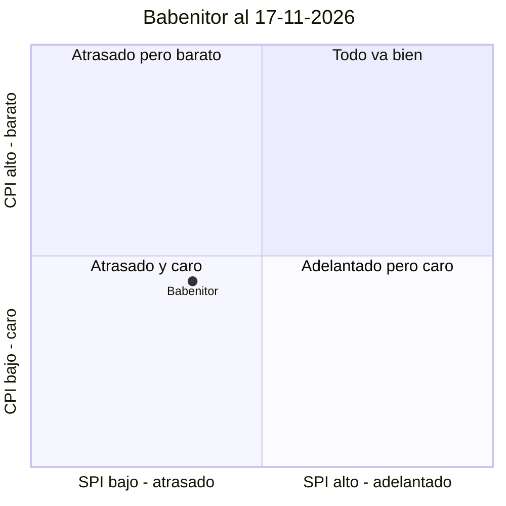
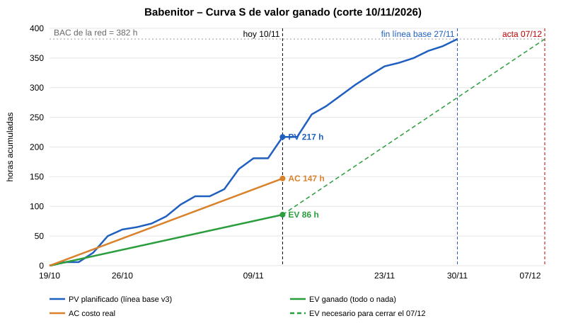

# Seguimiento y Métricas – Babenitor

**Proyecto:** Babenitor – Sistema Inteligente de Monitoreo y Seguridad para Bebés
**Fuentes:** `Docs/4. EDT.md` (alcance y criterios de aceptación), `Docs/5. Cronograma.md` (fechas de la línea base), `Docs/7. Estimación.md` (horas por paquete), `Docs/6. Presupuesto.md` (valor de la hora), lista de tareas completadas al 17/11/2026 informada por el equipo (estado real de los paquetes; el cierre de 2.5 lo confirmó el equipo el 17/11)
**Fecha de corte:** 17/11/2026
**Estado del documento:** Versión 3. Segundo corte de valor ganado, con las métricas de costo completas. **Las horas reales del 11/11 al 17/11 son una reconstrucción** (horas estimadas de lo cerrado en la semana menos 8 h de ahorro), porque no hubo buen seguimiento de horas (sección 3.3).

---

## Cambios frente al corte anterior

| Indicador | Corte 10/11/2026 | Corte 17/11/2026 |
| --------- | ---------------: | ---------------: |
| Paquetes terminados (de los 38 de la red) | 10 | **21** |
| PV | 217 h | **287 h** |
| EV | 86 h | **201 h** |
| AC | 147 h | **230 h** (reconstruido) |
| SPI | 0,40 | **0,70** |
| CPI | 0,59 | **0,87** |
| Cuadrante | Atrasado y caro | **Atrasado y caro** |
| Días hábiles hasta el 07/12/2026 | 18 | **14** |

---

## Decisiones y datos de entrada

| Dato | Valor | Origen |
| ---- | ----- | ------ |
| Regla de avance | **Todo o nada**: 0 % hasta cumplir el criterio de aceptación de la EDT y 100 % cuando se cumple | Codelab; decisión del equipo |
| Paquetes medidos | Los **38 paquetes de la red** del cronograma (382 h). 1.2, 1.3 y 1.4 (28 h, recurrentes) quedan fuera del PV y del EV, aunque aparezcan marcadas en la lista del 17/11 | Decisión del equipo |
| 3.8 Detección de movimiento anormal | **No aparece en la lista de tareas del 17/11.** Se trata como no terminada (0 %) hasta que el equipo confirme su estado | Criterio de este corte |
| 6.7 Historial de alertas | Aparece marcada en la lista, pero **salió del alcance en la EDT v3** (0 h, no está en la línea base). No suma al EV | EDT v3 |
| 2.5 Habitación de pruebas | **Terminada (100 %).** El equipo confirmó el 17/11 que cumple su criterio. Se cerró con las 4 h ya registradas al 10/11, sin horas nuevas | Confirmación del equipo |
| 6.3 Pantalla de estado reciente | **Vale 0 %.** Sigue sin cumplir su criterio: exige datos del servidor y sus predecesoras obligatorias 5.3 y 5.4 no están hechas | Decisión del equipo |
| Valor de la hora | $8.338 | Presupuesto, sección 4 |
| Costo real (AC) | **230 h** = 147 h al 10/11 + 83 h del 11/11 al 17/11. Las 83 h son una reconstrucción: 91 h estimadas para lo cerrado en la semana menos 8 h de ahorro | Sección 3.3 |
| Línea base | Cronograma y EDT **versión 3, congelados el 10/11/2026** | Decisión del equipo |
| Responsable de actualizar los números | **Jaime**, cada viernes | Decisión del equipo |

---

## 1. Para qué se mide

Se mide para poder corregir mientras todavía hay margen. Al 17/11/2026 quedan **14 días hábiles** (del 18/11 al 07/12) hasta el 07/12/2026, la fecha de fin del acta. Cada métrica de este documento tiene escrita la decisión que habilita (sección 5). Las que no habilitaban ninguna decisión se dejaron fuera (sección 5.2).

---

## 2. La línea base

| Componente            | De dónde sale                                       | Contenido                                                              |
| --------------------- | --------------------------------------------------- | ---------------------------------------------------------------------- |
| Línea base de alcance | EDT v3 y su diccionario                             | 41 paquetes, 410 h, cada uno con su criterio de aceptación             |
| Línea base de tiempo  | Cronograma nivelado v3                              | 38 paquetes con fecha de inicio y de fin, del 19/10/2026 al 27/11/2026 |
| Línea base de costo   | Estimación v1 (horas por paquete) × $8.338 por hora | 410 h = $3.418.580 de mano de obra; la red mide 382 h = $3.185.116     |

**Congelada el 10/11/2026 por el equipo** (registrada en el Paso 8 del cronograma).

**Regla:** la línea base solo cambia si se aprueba un cambio de alcance por control de cambios. Ese cambio se registra en el cronograma con su razón, quién lo aprobó y qué se recortó a cambio. **No se mueve porque el proyecto se atrase.** Por eso la decisión de la sección 4.3 (entregar el 07/12) **no cambia la línea base**: el SPI se sigue midiendo contra el plan v3 que termina el 27/11.

### Valor planificado acumulado de la línea base (PV)

Con la misma regla de todo o nada, el valor de cada paquete se cuenta en su fecha de fin planificada:

| Corte (fin del día) | PV acumulado | % de la red (382 h) |
| ------------------- | -----------: | ------------------: |
| Vie 23/10/2026 | 61 h | 16,0 % |
| Vie 30/10/2026 | 117 h | 30,6 % |
| Vie 06/11/2026 | 181 h | 47,4 % |
| Mar 10/11/2026 | 217 h | 56,8 % |
| Vie 13/11/2026 | 269 h | 70,4 % |
| **Mar 17/11/2026 (hoy)** | **287 h** | **75,1 %** |
| Vie 20/11/2026 | 336 h | 88,0 % |
| Vie 27/11/2026 | 382 h | 100,0 % |

---

## 3. Valor ganado al 17/11/2026

### 3.1 Valor planificado (PV): lo que debía estar terminado

29 paquetes tienen fecha de fin igual o anterior al 17/11/2026:

| Paquete | h | Fin planificado | ¿Terminado? |
| ------- | -: | --------------- | :---------: |
| 5.1 Arquitectura de comunicación | 6 | 19/10 | No |
| 5.2 Formato de mensajes | 6 | 21/10 | No |
| 6.1 Prototipo de interfaz | 10 | 21/10 | Sí |
| 1.1 Plan del proyecto | 16 | 22/10 | Sí |
| 5.8 Servidor intermediario | 12 | 22/10 | No |
| 2.1 Lista de componentes cotizada | 4 | 23/10 | Sí |
| 7.1 Plan de pruebas | 7 | 23/10 | Sí |
| 2.2 Componentes recibidos | 4 | 26/10 | Sí |
| 2.3 Componentes verificados | 6 | 27/10 | Sí |
| 2.5 Habitación de pruebas | 4 | 28/10 | Sí |
| 3.1 Firmware base del ESP32 #1 | 8 | 28/10 | Sí |
| 4.1 Firmware base y lectura del sensor | 8 | 29/10 | Sí |
| 6.2 Base de la app y recepción en segundo plano | 12 | 29/10 | Sí |
| 3.2 Captura de imágenes | 10 | 30/10 | Sí |
| 4.3 Estabilización de lecturas | 4 | 30/10 | Sí |
| 5.3 Envío de datos del ESP32 #1 al servidor | 12 | 04/11 | No |
| 3.3 Detección de la posición del bebé | 20 | 05/11 | Sí |
| 6.4 Configuración de zonas | 14 | 05/11 | No |
| 3.4 Captura de audio | 10 | 06/11 | Sí |
| 5.4 Envío de datos del ESP32 #2 al servidor | 8 | 06/11 | No |
| 3.8 Detección de movimiento anormal | 16 | 10/11 | No |
| 5.5 Intercambio de datos entre los ESP32 | 8 | 10/11 | No |
| 6.3 Pantalla de estado reciente | 12 | 10/11 | No |
| 3.5 Detección de llanto | 16 | 12/11 | Sí |
| 6.5 Motor de alertas | 22 | 12/11 | Sí |
| 2.4 Prototipo físico armado | 10 | 13/11 | No |
| 3.6 Detección de sonidos fuertes | 4 | 13/11 | Sí |
| 4.2 Calibración contra termómetro | 10 | 17/11 | Sí |
| 6.6 Notificaciones al cuidador | 8 | 17/11 | Sí |
| **PV** | **287** | | |

### 3.2 Valor ganado (EV): lo terminado de verdad

| Paquete | h | Cierre |
| ------- | -: | ------ |
| 1.1 Plan del proyecto | 16 | Antes del 10/11 |
| 2.1 Lista de componentes cotizada | 4 | Antes del 10/11 |
| 2.2 Componentes recibidos | 4 | Antes del 10/11 |
| 2.3 Componentes verificados | 6 | Antes del 10/11 |
| 3.1 Firmware base del ESP32 #1 | 8 | Antes del 10/11 |
| 3.2 Captura de imágenes | 10 | Antes del 10/11 |
| 3.4 Captura de audio | 10 | Antes del 10/11 |
| 4.1 Firmware base y lectura del sensor | 8 | Antes del 10/11 |
| 4.2 Calibración contra termómetro | 10 | Antes del 10/11 |
| 6.1 Prototipo de interfaz | 10 | Antes del 10/11 |
| *Subtotal del corte anterior* | *86* | |
| 2.5 Habitación de pruebas | 4 | Nuevo |
| 3.3 Detección de la posición del bebé | 20 | Nuevo |
| 3.5 Detección de llanto | 16 | Nuevo |
| 3.6 Detección de sonidos fuertes | 4 | Nuevo |
| 3.7 Calibración y pruebas del ESP32 #1 (adelantado: planificado el 18/11) | 14 | Nuevo |
| 4.3 Estabilización de lecturas | 4 | Nuevo |
| 4.4 Pruebas del ESP32 #2 (adelantado: planificado el 18/11) | 4 | Nuevo |
| 6.2 Base de la app y recepción en segundo plano | 12 | Nuevo |
| 6.5 Motor de alertas | 22 | Nuevo |
| 6.6 Notificaciones al cuidador | 8 | Nuevo |
| 7.1 Plan de pruebas | 7 | Nuevo |
| *Subtotal nuevo desde el 10/11* | *115* | |
| **EV** | **201** | |

**Atrasados:** 10 paquetes que debían estar terminados no lo están, con **104 h** en total (287 − 183). Hay dos adelantos: 3.7 y 4.4 (18 h, planificados para el 18/11).

| Paquete atrasado | h |
| ---------------- | -: |
| 5.1, 5.2, 5.3, 5.4, 5.5 y 5.8 (todo el bloque 5.0) | 52 |
| 3.8 Detección de movimiento anormal | 16 |
| 6.4 Configuración de zonas | 14 |
| 6.3 Pantalla de estado reciente | 12 |
| 2.4 Prototipo físico armado | 10 |
| **Total** | **104** |

**Bloque más atrasado:** 5.0 Comunicación sigue en **0 h ganadas de 52 h**. 5.1, 5.2 y 5.8 debían cerrarse entre el 19 y el 22/10. Del bloque dependen 6.3 (necesita 5.3 y 5.4), 5.5 y la integración 7.2. Es además la incógnita n.º 1 de la ficha del proyecto: no sabemos si los ESP32 se comunican de forma estable.

**Hitos de la línea base:**

| Hito | Fecha | Estado al 17/11 |
| ---- | ----- | --------------- |
| H1 – Plan del proyecto entregado | 22/10 | Cumplido (1.1 terminado) |
| H2 – Hardware verificado | 27/10 | Cumplido (2.3 terminado) |
| H3 – Diseño del prototipo listo | 23/10 | **No cumplido**: faltan 5.1 y 5.2 |
| H4 – ESP32 integrados | 10/11 | **No cumplido**: falta 5.5 |
| H5 – Primera versión funcional | 19/11 | **En riesgo**: 7.2 necesita 2.4 y 5.5, que no están hechas |

**Coherencia de dependencias (por verificar).** Se respeta el estado informado por el equipo, pero cuatro paquetes marcados como terminados tienen predecesoras obligatorias sin terminar:

| Paquete marcado | Predecesora sin terminar | h en el EV |
| --------------- | ------------------------ | ---------: |
| 6.2 Base de la app y recepción en segundo plano | 5.8 (su criterio pide recibir datos del servidor durante 10 minutos) | 12 |
| 6.5 Motor de alertas | 6.3 y 6.4 | 22 |
| 6.6 Notificaciones al cuidador | Descansa en 6.5 | 8 |
| 3.7 Calibración y pruebas del ESP32 #1 | 3.8 (3.7 reporta también los resultados de 3.8) | 14 |

Si el A de la RACI no confirma el criterio de esos cuatro paquetes y se reabren, el EV baja a **145 h** y el SPI a **0,51**. Son 56 h de valor que dependen de esa verificación (sección 11, punto 3).

### 3.3 Costo real (AC): lo que se gastó

> El AC cuenta **todas** las horas gastadas, también las de paquetes sin terminar, y no incluye las horas de 1.2, 1.3 y 1.4, igual que el PV y el EV.

**Cómo se obtuvo el AC de este corte.** Al 10/11 había 147 h registradas. Del 11/11 al 17/11 **no hubo buen seguimiento de horas**, así que esa semana se reconstruyó: el equipo informó que lo cerrado en la semana costó algo menos que lo estimado, y se fijó un **ahorro total de 8 h** repartido entre los otros 10 paquetes cerrados en la semana. Cada uno se hizo en menos tiempo del estimado. 2.5 se cerró sin horas nuevas: sus 4 h estimadas ya estaban gastadas al 10/11.

Horas que faltaban al 10/11 para cerrar cada paquete (estimadas) frente a las reconstruidas:

| Paquete cerrado en la semana | Horas pendientes estimadas al 10/11 | Horas reales de la semana | Ahorro |
| ---------------------------- | ----------------------------------: | ------------------------: | -----: |
| 2.5 Habitación de pruebas | 0 (4 estimadas menos 4 ya gastadas) | 0 | 0 |
| 3.3 Detección de la posición del bebé | 6 (20 estimadas menos 14 ya gastadas) | 5,5 | 0,5 |
| 3.5 Detección de llanto | 16 | 14,5 | 1,5 |
| 3.6 Detección de sonidos fuertes | 4 | 3,5 | 0,5 |
| 3.7 Calibración y pruebas del ESP32 #1 | 14 | 13,0 | 1,0 |
| 4.3 Estabilización de lecturas | 4 | 3,5 | 0,5 |
| 4.4 Pruebas del ESP32 #2 | 4 | 3,5 | 0,5 |
| 6.2 Base de la app y recepción en segundo plano | 6 (12 estimadas menos 6 ya gastadas) | 5,5 | 0,5 |
| 6.5 Motor de alertas | 22 | 20,0 | 2,0 |
| 6.6 Notificaciones al cuidador | 8 | 7,5 | 0,5 |
| 7.1 Plan de pruebas | 7 | 6,5 | 0,5 |
| **Total** | **91** | **83** | **8,0** |

El ahorro de 8 h es el dato del equipo. Su reparto por paquete es proporcional al tamaño del trabajo, en pasos de 0,5 h, y se corrige cuando exista el registro real. La reconstrucción supone además que las horas de la semana se dedicaron a cerrar estos paquetes y que **no se gastaron horas nuevas** en los que siguen abiertos (5.1, 6.3 y 6.4).

Horas por paquete al 17/11:

| Paquete | Estado | Horas estimadas | Horas reales |
| ------- | ------ | --------------: | -----------: |
| 1.1 Plan del proyecto | Terminado | 16 | 18 |
| 2.1 Lista de componentes cotizada | Terminado | 4 | 4 |
| 2.2 Componentes recibidos | Terminado | 4 | 5 |
| 2.3 Componentes verificados | Terminado | 6 | 7 |
| 3.1 Firmware base del ESP32 #1 | Terminado | 8 | 10 |
| 3.2 Captura de imágenes | Terminado | 10 | 14 |
| 3.4 Captura de audio | Terminado | 10 | 12 |
| 4.1 Firmware base y lectura del sensor | Terminado | 8 | 9 |
| 4.2 Calibración contra termómetro | Terminado | 10 | 12 |
| 6.1 Prototipo de interfaz | Terminado | 10 | 10 |
| *Subtotal terminados antes del 10/11* | | *86* | *101* |
| 2.5 Habitación de pruebas | Terminado | 4 | 4 (todas antes del 10/11) |
| 3.3 Detección de la posición del bebé | Terminado | 20 | 19,5 (14 + 5,5) |
| 3.5 Detección de llanto | Terminado | 16 | 14,5 |
| 3.6 Detección de sonidos fuertes | Terminado | 4 | 3,5 |
| 3.7 Calibración y pruebas del ESP32 #1 | Terminado | 14 | 13 |
| 4.3 Estabilización de lecturas | Terminado | 4 | 3,5 |
| 4.4 Pruebas del ESP32 #2 | Terminado | 4 | 3,5 |
| 6.2 Base de la app y recepción en segundo plano | Terminado | 12 | 11,5 (6 + 5,5) |
| 6.5 Motor de alertas | Terminado | 22 | 20 |
| 6.6 Notificaciones al cuidador | Terminado | 8 | 7,5 |
| 7.1 Plan de pruebas | Terminado | 7 | 6,5 |
| *Subtotal terminados desde el 10/11* | | *115* | *107* |
| *Subtotal terminados* | | *201* | *208* |
| 6.3 Pantalla de estado reciente | En curso | 12 | 12 |
| 6.4 Configuración de zonas | En curso | 14 | 6 |
| 5.1 Arquitectura de comunicación | En curso | 6 | 4 |
| *Subtotal en curso (valen 0 en el EV)* | | | *22* |
| **AC** | | | **230** |

Comprobación: 147 h al 10/11 + 83 h de la semana = 230 h. El AC no incluye 1.2, 1.3 y 1.4.

**Sensibilidad:** si el ahorro de la semana hubiera sido 0 h en lugar de 8 h, el AC sería 238 h y el CPI 0,84. Entre ambos extremos la conclusión del cuadrante no cambia.

### 3.4 Las dos distancias y los dos índices

| Indicador | Fórmula | Horas | Pesos ($8.338/h) | Lectura |
| --------- | ------- | ----: | ---------------: | ------- |
| PV | — | 287 | $2.393.006 | Lo que debía estar hecho |
| EV | — | 201 | $1.675.938 | Lo hecho de verdad |
| AC | — | 230 | $1.917.740 | Lo gastado (reconstruido) |
| **Variación de cronograma (SV)** | EV − PV | **−86** | −$717.068 | Se hizo menos de lo previsto |
| **Variación de costo (CV)** | EV − AC | **−29** | −$241.802 | Se gastó más de lo que vale lo hecho |
| **SPI** | EV / PV | **0,70** | | Se avanza al 70 % del ritmo planificado |
| **CPI** | EV / AC | **0,87** | | Cada hora de trabajo produce 0,87 h de valor planificado |

Cálculos: SPI = 201 / 287 = 0,700 · CPI = 201 / 230 = 0,874. Al 10/11 eran SPI 0,40 y CPI 0,59.

Siguen siendo dos problemas distintos. El de **ritmo** (SPI) se redujo, pero persiste: **104 h de paquetes con fecha vencida siguen abiertas**. El de **eficiencia** (CPI) mejoró mucho: en lo cerrado esta semana se gastó menos de lo estimado. Aun así el acumulado sigue por debajo de 1,0, porque las primeras semanas costaron más de lo estimado y hay 22 h gastadas en paquetes que todavía no producen valor.

### 3.5 Cuadrante

Escala de 0 a 2 en cada eje, con el 1,0 en el centro. Babenitor está en SPI 0,70 y CPI 0,87 (el 10/11 estaba en 0,40 y 0,59).

**Babenitor sigue en el cuadrante «atrasado y caro», pero más cerca del centro.** Se mantiene la decisión de la sección 4.3, cuyo cumplimiento se revisa en la sección 4.4.

---

## 4. Curva S y pronóstico

### 4.1 Curva S

> **Pendiente:** la imagen `img/curva_s.svg` conserva el corte del 10/11. Hay que regenerarla con los puntos de la tabla siguiente.

| Corte | PV | EV | AC |
| ----- | -: | -: | -: |
| 19/10/2026 (inicio) | 0 | 0 | 0 |
| 10/11/2026 | 217 | 86 | 147 |
| 17/11/2026 | 287 | 201 | 230 |

- **Azul (PV):** el plan de la línea base v3, acumulado por fecha de fin de cada paquete, hasta las 382 h del 27/11.
- **Verde (EV):** lo ganado con todo o nada. Hay dos cortes reales; entre ellos la línea es una recta y no muestra la forma real de los días intermedios.
- **Naranja (AC):** costo real. El punto del 17/11 es reconstruido.
- **Verde punteado:** el ritmo de valor ganado que haría falta para terminar la red el 07/12/2026.

Desde el 20/11 se agrega un punto por corte semanal (sección 8). La gráfica se regenera con los datos de la tabla de tendencia.

### 4.2 Lo que dicen los números

| Concepto | Valor |
| -------- | ----: |
| Trabajo que falta (382 − 201) | 181 h de valor |
| Días hábiles hasta el 07/12/2026 | 14 |
| Valor ganado necesario por día | **12,9 h** (al 10/11 eran 16,4 h) |
| Valor ganado por día hasta hoy (201 / 20 días) | 10,1 h |
| Valor ganado por día del 11/11 al 17/11 (115 h / 4 días) | 28,8 h |
| Días hábiles para ganar lo que falta al ritmo acumulado (181 / 10,1) | 18,0, más de los 14 disponibles |
| Días hábiles para ganar lo que falta al ritmo de la última semana (181 / 28,8) | 6,3 |
| Capacidad que queda (5 personas × 4 h × 14 días) | 280 h |
| Esfuerzo necesario al CPI actual (181 / 0,874) | **207 h**, que **caben** en 280 h (74 % de la capacidad) |
| CPI mínimo para que quepa (181 / 280) | **0,65** (el CPI actual de 0,87 lo supera) |
| Pronóstico del costo final al ritmo actual (382 / 0,874) | **437 h** ($3.643.706), frente a las 382 h ($3.185.116) del plan: 55 h más |

Con la eficiencia actual (CPI 0,87), lo que falta cuesta unas 207 h y cabe en la capacidad restante. **Desde el punto de vista del esfuerzo, la entrega del 07/12 es alcanzable**; con el ritmo acumulado de todo el período no lo sería, y sí con cerca de la mitad del ritmo de la última semana. El pronóstico de 437 h supera en 55 h el plan de 382 h y es más que la reserva de contingencia de 19,7 h de la estimación; la métrica 2 lo vigila. Tres condiciones sostienen este pronóstico: que el bloque 5.0 se cierre ya (52 h de valor, bloquea 6.3 y 7.2), que los 21 paquetes terminados cumplan de verdad sus criterios (sección 11, punto 3) y que el AC reconstruido se confirme con el registro real (sección 11, punto 1). El pronóstico completo (EAC, ETC e índice de trabajo por completar) se trabaja en el codelab `evm-seguimiento-proyectos`.

### 4.3 Decisión del cuadrante rojo (10/11/2026)

**Decidido por el equipo:** usar la fecha del acta y cambiar la forma de trabajar.

1. **Fecha de entrega comprometida: 07/12/2026**, la fecha de fin del acta, en lugar del 27/11/2026 calculado. No requiere aprobación de los patrocinadores porque no pasa de la fecha del acta. **La línea base no se mueve:** se sigue midiendo contra la v3 y queda registrado que la holgura de 6 días hábiles se consumió por atraso.
2. **Cambiar la forma de trabajar:**
   - **Registro diario de horas reales** por persona y por paquete desde el 11/11/2026 (sección 7).
   - **Límite de trabajo en curso: un paquete por persona** (como máximo 5 a la vez). No se empieza un paquete nuevo mientras haya uno propio sin cerrar (sección 6).
   - **Primero se cierra lo empezado** (3.3, 6.3, 6.2, 6.4, 5.1 y 2.5) y después el bloque 5.0, que tiene 0 h ganadas y bloquea la app y la integración.
   - **Sostener las 20 h por semana por persona** que supone el cronograma. Lo vigila la métrica 3 del tablero.
3. **Recorte de reserva, preaprobado y con disparador.** Si en dos cortes semanales seguidos el valor ganado de la semana queda por debajo del 80 % del necesario (16,4 h por día hábil), se aplica el recorte que ya fija el cronograma, en este orden: 3.6 (sonidos fuertes) simplificada, 5.5 (intercambio entre ESP32) simplificada y 7.7 (documentación) reducida al manual de uso. Las horas que se ahorran se re-estiman cuando se active el recorte.

**Por qué no basta con «esforzarse más»:** hace falta subir el ritmo de valor ganado unas tres veces (de 5,4 a 16,4 h por día). Eso solo es posible si las horas reales suben hacia las 20 h por día del equipo **y** la eficiencia sube a 0,82 o más. Si en el corte del 20/11 no se ven las dos cosas, el recorte se aplica sin discusión.

### 4.4 Cumplimiento de la decisión al 17/11/2026

| Compromiso de la sección 4.3 | Estado al 17/11 |
| ---------------------------- | --------------- |
| Entrega el 07/12/2026 | Se mantiene. El valor ganado necesario por día bajó de 16,4 a 12,9 h |
| Registro diario de horas reales | **No se cumplió** en la semana del 11 al 17/11: no hubo buen seguimiento y las horas de la semana se reconstruyeron (sección 3.3) |
| Límite de trabajo en curso (5 a la vez) | Se cumple: 3 paquetes abiertos con horas gastadas (5.1, 6.3 y 6.4), bajo el supuesto de que no se abrió ninguno nuevo |
| Primero se cierra lo empezado | Cerrados 3.3, 6.2 y 2.5. Siguen abiertos 6.3, 6.4 y 5.1. El bloque 5.0 sigue en 0 h |
| Sostener 20 h por semana por persona | Con el dato reconstruido: 83 h en 4 días hábiles, 20,8 h por día frente a las 20 h por día del plan |
| Eficiencia de 0,82 o más (condición del 4.3) | CPI de 0,87 con el dato reconstruido; 0,84 aun sin ahorro. **Se cumple, pendiente de confirmar con registro real** |
| Disparador del recorte de reserva | **No se activa.** El valor ganado de la última semana (28,8 h por día) supera el 80 % del necesario (80 % de 12,9 = 10,3 h por día). El control de horas y eficiencia sigue siendo el corte del 20/11 |

---

## 5. Tablero del equipo

### 5.1 Las cinco métricas

Una o dos por grupo: avance, esfuerzo, calidad y flujo.

| # | Grupo | Métrica | Valor al 17/11 | Decisión que habilita |
| - | ----- | ------- | -------------- | --------------------- |
| 1 | Avance | **SPI acumulado** (EV / PV, todo o nada) | 0,70 (10/11: 0,40) | Si no sube entre dos cortes seguidos, se activa el recorte de reserva (4.3, punto 3). Si sube por encima de 1,0, se revisa si la estimación de lo que falta es demasiado conservadora |
| 2 | Esfuerzo | **CPI acumulado** (EV / AC) | 0,87 (10/11: 0,59). Reconstruido: 0,84 sin ahorro | Si queda por debajo del mínimo que cabe en la capacidad restante (0,65 al 17/11), lo que falta no cabe: se re-estiman las horas restantes del bloque más desviado y se decide en la revisión si se usa la reserva de 19,7 h o se recorta |
| 3 | Esfuerzo | **Horas reales del equipo por semana** frente a 100 h de capacidad | Semana del 11 al 17/11: 83 h en 4 días hábiles (≈ 104 h en una semana de 5 días). Acumulado: 230 h en 20 días ≈ 57 h por semana (10/11: ≈ 46 h) | Si queda por debajo de 80 h por semana, la dedicación no se sostiene y se aplica el punto 2 de la estimación: se recorta alcance ya, no al final |
| 4 | Flujo | **Trabajo en curso**: paquetes empezados sin cumplir su criterio | 3 (5.1, 6.3 y 6.4). Al 10/11 eran 6 | Si supera 5 (más de uno por persona), nadie empieza un paquete nuevo hasta cerrar uno |
| 5 | Calidad | **Defectos que llegan al usuario**: fallos que aparecen después de cerrar un paquete (en 7.2 a 7.5 o en las sesiones de prueba con Marcela Ríos) | Sin datos (aún no hay pruebas con la usuaria) | Cada defecto **reabre** el paquete (su EV vuelve a 0). Con 2 o más en un mismo bloque, se agrega un caso al plan de pruebas (7.1) para ese bloque |

Las métricas 2, 3 y 4 de este corte se apoyan en el AC reconstruido; se confirman con el registro real de horas.

**Filtro de tres preguntas:**

| Métrica | ¿Qué decisión? | ¿Le conviene al equipo manipularla? | ¿Cuesta poco? |
| ------- | -------------- | ----------------------------------- | ------------- |
| SPI | Recortar o no (arriba) | Sí: marcar paquetes como hechos antes de tiempo. **Protección:** todo o nada, y el A del paquete en la RACI verifica el criterio de la EDT antes de marcarlo | Sí, sale del archivo `ev` en 5 minutos |
| CPI | Re-estimar o usar la reserva | Sí: anotar menos horas. **Protección:** cada persona registra a diario y no se reconstruye al final de la semana | Sí, 1 minuto por persona al día |
| Horas por semana | Recortar por falta de dedicación | Sí: inflar horas. **Protección:** las horas sin paquete asociado no cuentan, y un CPI que cae al subir las horas lo delata | Sí, es la suma del mismo registro |
| Trabajo en curso | Dejar de empezar | Poco: los paquetes son los de la EDT y no se parten | Sí, se cuenta en la reunión diaria |
| Defectos al usuario | Reabrir y reforzar pruebas | Sí: no reportarlos. **Protección:** los registra quien prueba, no quien construyó el paquete | Sí, una línea en el acta (1.2) |

### 5.2 Lo que no se mide, y por qué

| Métrica descartada | Razón |
| ------------------ | ----- |
| Líneas de código, número de commits | Se optimizan solas (código más largo, commits más pequeños) y no cambian ninguna decisión |
| Porcentaje de avance «a ojo» de cada paquete | Es la fuente número uno de mediciones infladas; la reemplaza la regla de todo o nada |
| Cobertura de pruebas | Se manipula con facilidad; los criterios de aceptación de la EDT ya dicen qué se prueba (p. ej. 8 de 10 aciertos) |
| Métricas DORA | No hay despliegues a producción durante el semestre (la app solo se publica en Google Play si se decide, según el presupuesto). Se reconsideran si se publica |
| Tiempo de ciclo como métrica separada | Se obtiene de las métricas 4 y de entrega con la ley de Little (sección 6); no hace falta registrarlo aparte |

---

## 6. Métricas de flujo

| Métrica | Valor al 17/11 |
| ------- | -------------- |
| Trabajo en curso | 3 paquetes (al 10/11: 6) |
| Ritmo de entrega | 21 paquetes en 20 días hábiles (4,0 semanas) ≈ **5,3 paquetes por semana** (al 10/11: 3,1). En los últimos 4 días hábiles se cerraron 11 paquetes |
| Tiempo de espera según la ley de Little (3 / 5,3) | **≈ 0,6 semanas por paquete** (al 10/11: 1,9) |

Los paquetes del cronograma duran de 1 a 4 días. Con 3 paquetes en curso y el ritmo actual, la espera por paquete baja a menos de una semana. Si se abrieran los 5 permitidos, subiría a 1,0 semana. La cifra depende de contar bien el trabajo en curso en la reunión diaria.

---

## 7. Cadencia de revisión

| Cada | Quién | Qué se mira | Dura | Sale con |
| ---- | ----- | ----------- | ---- | -------- |
| Día hábil | Los cinco integrantes | Qué está bloqueado y cuánto trabajo en curso hay (métrica 4) | 10 min | Desbloqueos y quién cierra qué |
| Viernes | Los cinco integrantes; **Jaime** actualiza los números antes de la reunión | SPI, CPI, horas de la semana, trabajo en curso, defectos y riesgos disparados | 20 min | **Una decisión escrita** en el acta semanal (1.2) |
| Hito de entrega (H5, H6 y H7) | Equipo, Marcela Ríos (usuaria) y patrocinadores | El producto funcionando contra los criterios del acta | Lo que haga falta | Aceptación o lista de defectos (métrica 5) |

**Cómo se actualizan los números (lo hace Jaime cada viernes):**

1. Cada integrante registra **a diario** sus horas en el archivo de corte de la semana (`Docs/evDD-MM-AAAA.md`), en una tabla con las columnas *fecha · persona · paquete · horas*.
2. El viernes, Jaime copia el archivo de corte anterior con la fecha nueva y marca los paquetes que cumplieron su criterio. Antes de marcarlos los confirma con el A de la RACI.
3. Calcula PV (tabla de la sección 2), EV y AC, y agrega una fila a la tabla de tendencia (sección 8).
4. Si en la revisión no se toma ninguna decisión, se deja escrito en el acta que no hubo decisión. Si eso pasa **dos semanas seguidas**, el problema no son las métricas y se trata como un riesgo en 1.3.

---

## 8. Tendencia semanal (reto adicional)

El valor de un corte dice poco. La tendencia dice si el proyecto se recupera o se deteriora.

| Corte | PV | EV | AC | SPI | CPI | Cuadrante | Decisión tomada |
| ----- | -: | -: | -: | --: | --: | --------- | --------------- |
| 10/11/2026 | 217 | 86 | 147 | 0,40 | 0,59 | Atrasado y caro | Entrega el 07/12, registro diario de horas, límite de trabajo en curso y recorte de reserva con disparador (4.3) |
| 13/11/2026 | 269 | — | — | — | — | Sin corte registrado | — |
| 17/11/2026 | 287 | 201 | 230 (reconstruido) | 0,70 | 0,87 | Atrasado y caro | Por registrar en el acta del corte |
| 20/11/2026 | 336 | | | | | | |
| 27/11/2026 | 382 | | | | | | |
| 04/12/2026 | 382 | | | | | | |

Cómo leerla: un CPI estable en 0,8 indica una estimación optimista. Un CPI que viene bajando indica un proyecto que se deteriora, y las dos situaciones piden decisiones distintas. Del 10/11 al 17/11 el SPI pasó de 0,40 a 0,70 y el CPI de 0,59 a 0,87: el proyecto se recupera en las dos medidas, aunque el CPI de este corte es una reconstrucción. Desde el 27/11 el PV ya no crece, porque la línea base terminaba ese día. A partir de ahí el SPI solo sube si el EV alcanza al PV.

---

## 9. Errores comunes que se evitaron

| Error | Qué se hizo |
| ----- | ----------- |
| Mover la línea base cuando hay retraso | La v3 queda congelada. La entrega del 07/12 es una decisión aparte y el SPI se sigue midiendo contra el 27/11 |
| Porcentajes de avance inventados | Todo o nada. 6.3 sigue en 0 % porque no cumple su criterio |
| Medirlo todo | Cinco métricas, y las descartadas tienen su razón escrita |
| Medir solo avance | Hay métricas de esfuerzo (2 y 3), flujo (4) y calidad (5) como contrapeso |
| Convertir la métrica en objetivo | Cada métrica tiene una protección contra su manipulación (sección 5.1) |
| Reuniones de seguimiento sin decisiones | La revisión de los viernes termina con una decisión escrita. La del 10/11 terminó en la de la sección 4.3; la de este corte debe registrar la suya en el acta |
| Recurrentes contados como terminados | 1.2, 1.3 y 1.4 aparecen marcadas en la lista del 17/11, pero son recurrentes, están fuera de la red y no suman al PV ni al EV |
| Contar lo que no está en la línea base | 6.7 aparece marcada, pero salió del alcance en la EDT v3 y no suma |
| Presentar como real un dato reconstruido | Las horas del 11 al 17/11 están marcadas como reconstruidas y con su sensibilidad (sección 3.3) |

---

## 10. Validación

| Pregunta | Respuesta |
| -------- | --------- |
| ¿La línea base está congelada y se sabe la fecha en que se congeló? | **Sí.** Versión 3, congelada el 10/11/2026 por el equipo (sección 2 y Paso 8 del cronograma). |
| ¿Se calcularon PV, EV y AC con la regla de todo o nada? | **Sí, con una salvedad.** PV = 287 h, EV = 201 h y AC = 230 h. El AC de la semana del 11 al 17/11 es una reconstrucción (secciones 3.1 a 3.3). |
| ¿Sabemos en qué cuadrante de SPI y CPI está el proyecto? | **Sí.** Atrasado y caro: SPI 0,70, CPI 0,87 (sección 3.5). |
| ¿El tablero tiene al menos una métrica de avance, de esfuerzo, de calidad y de flujo? | **Sí.** SPI; CPI y horas por semana; defectos que llegan al usuario; trabajo en curso (sección 5.1). |
| ¿Cada métrica del tablero tiene escrita la decisión que habilita? | **Sí.** Sección 5.1, con el filtro de tres preguntas. |
| ¿La cadencia de revisión está acordada por escrito? | **Sí.** Diaria de 10 min, semanal de 20 min los viernes con números actualizados por Jaime, y revisión en cada hito con la usuaria (sección 7). |
| ¿La última revisión terminó en una decisión, y no solo en información? | **Pendiente.** La última decisión registrada es la del 10/11 (sección 4.3). La revisión de este corte debe dejar la suya en el acta. |

---

## 11. Puntos a revisar

1. **Reemplazar el AC reconstruido por el real.** Las 83 h del 11 al 17/11 salen de las horas estimadas menos 8 h de ahorro, no de un registro. Si el ahorro real fue menor, el CPI baja hasta 0,84 (ahorro de 0 h); si se gastaron horas en paquetes abiertos (5.1, 6.3 o 6.4), el AC sube. Desde ahora el registro diario es obligatorio (sección 7).
2. **Bloque 5.0 Comunicación.** Sigue en 0 h ganadas de 52 h y es la incógnita principal de la ficha. Bloquea 6.3 (necesita 5.3 y 5.4) y la integración 7.2 (necesita 5.5). Con H5 planificado para el 19/11, hay que decidir esta semana quién cierra 5.1, 5.2 y 5.8, y en qué orden.
3. **Criterios cumplidos de verdad.** El EV subió 115 h en 4 días hábiles (28,8 h por día), frente a una capacidad de 20 h por día. Es posible solo si parte del trabajo ya estaba avanzado al 10/11 (había 46 h gastadas en paquetes en curso) o si algún criterio se marcó antes de tiempo. Antes de dejar el EV, el A de la RACI debe verificar el criterio de 6.2 (pide recibir datos del servidor, y 5.8 no está hecha), 6.5 (pide 6.3 y 6.4), 6.6 (descansa en 6.5) y 3.7 (incluye los resultados de 3.8). Si se reabren, el EV baja a 145 h y el SPI a 0,51 (sección 3.2); el CPI también bajaría, porque sus horas ya están gastadas. Conviene revisar con el mismo rigor 3.3, 3.5 y 3.6.
4. **Estado de 3.8 y de 6.7.** 3.8 Detección de movimiento anormal (16 h) no aparece en la lista de tareas del 17/11; se trató como no terminada. 6.7 aparece marcada pero salió del alcance en la EDT v3; no suma. El equipo debe confirmar ambos casos.
5. **Hitos incumplidos.** H3 (23/10) y H4 (10/11) no se cumplieron en su fecha, y H5 (19/11) está en riesgo porque faltan 2.4 y 5.5. Hay que avisar a los patrocinadores, que siguen los hitos del acta.
6. **Holgura consumida.** Con la entrega al 07/12/2026 ya no queda margen frente al acta. Cualquier atraso nuevo se resuelve con el recorte de reserva (4.3, punto 3), no con otra fecha. El control del 20/11 sigue vigente.
7. **Sobrecosto proyectado.** Al CPI actual, el costo final de la red sería de 437 h frente a las 382 h del plan (55 h más, sección 4.2). Cabe en la capacidad restante, pero supera la reserva de 19,7 h. Se vigila con la métrica 2.
8. **Curva S.** Regenerar `img/curva_s.svg` con los cortes del 10/11 y del 17/11 (sección 4.1).
